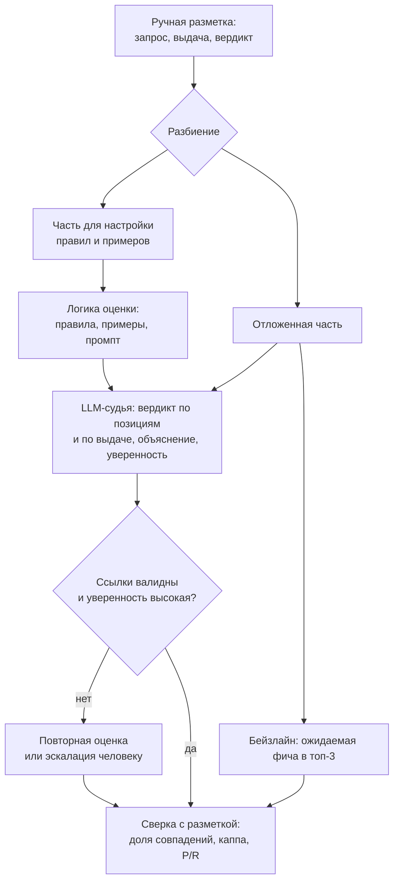
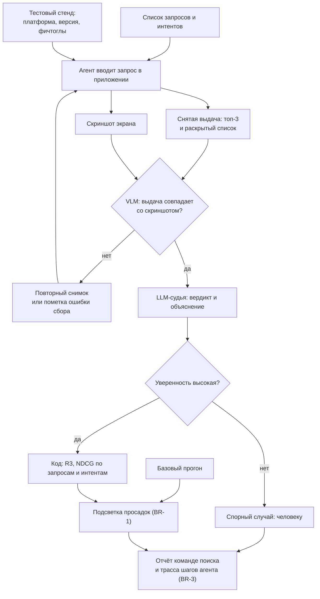

# ML System Design Doc — [RU]

## Дизайн ML-системы: AI-оценщик поисковой выдачи Альфа-Онлайн и Альфа-Мобайл, MVP, итерация 1

*Документ составлен по структуре [шаблона ML System Design Doc от Reliable ML](https://github.com/IrinaGoloshchapova/ml_system_design_doc_ru/blob/main/ML_System_Design_Doc_Template.md). Источники: описание кейса «Автоматизация тестирования с помощью ИИ» (Альфа-Банк) и BRD «Тестирование выдачи поиска». Всё, чего нет в этих материалах, помечено как **допущение** или **TBD** и вынесено в вопросы к заказчику (раздел 3).*

> **Статус согласования.** Ответов заказчика на наши вопросы пока нет. Поэтому пороги, формат разметки, доступы к моделям и стенду описаны как допущения. Документ дополним после ответов и после получения первых примеров разметки (до 13.11.2026).
>
> **Данные.** Данных банка у команды пока нет. EDA для раздела 2.3 выполнен на публичных **прокси-датасетах** (WANDS, ESCI LLM-judged, banking77_ru, synthetic-search-queries-ru) и на синтетическом каталоге фич, с явной пометкой «прокси до получения данных банка»: [ноутбук](../notebooks/eda.ipynb), [отчёт](../reports/eda/README.md). После получения разметки EDA повторяем на реальных данных тем же ноутбуком.

> **Термины**
> - **Фича** — функция или продукт банка в приложении: кредит наличными, заправки, переводы.
> - **Выдача** — упорядоченный список фич, который приходит в ответ на поисковый запрос.
> - **Интент** — цель клиента, за которой стоит группа запросов, например «вклады».
> - **Топ-3** — результаты, которые клиент видит без раскрытия списка.
> - **Точка** — один размеченный пример: запрос, выдача, вердикт, объяснение.
> - **Эталон (ground truth)** — ручная разметка, которую считаем правдой.
> - **R3** — сколько из топ-3 релевантны интенту.
> - **NDCG** — насколько высоко в выдаче стоят самые релевантные фичи.
> - **CTR3** — на что из топ-3 кликнули и насколько это правильно.
> - **Классификатор** — модель банка, которая подбирает фичи к запросу. Это объект тестирования, а не часть нашей системы.
> - **Фичтогл** — переключатель, который включает фичу не всем клиентам.
> - **AlfaGen** — внутренняя платформа банка с языковыми моделями.
> - **LLM-судья** — языковая модель, которая выносит вердикт о релевантности выдачи по заданным правилам.

### 1. Цели и предпосылки

#### 1.1. Зачем идем в разработку продукта?

**Бизнес-цель.** Снять с команды поиска часть ручной проверки выдачи и быстрее находить просадки качества поиска в «Альфа-Онлайн» и «Альфа-Мобайл».

**Проблема сейчас:**
- Клиент без раскрытия списка видит только три результата, поэтому релевантная фича обязана попадать в топ-3.
- Выдачу проверяют люди вручную. Кейсов много, поэтому смотрят выборочно, и часть запросов не проверяется совсем.
- Просадки замечают с опозданием. Когда в поиск добавляют новые фичи, классификатор может деградировать на старых запросах, и нужная фича съезжает ниже.

**Почему станет лучше с ML.** Правилами типа «точное совпадение заголовка» релевантность не оценить: клиенты формулируют запросы по-разному («вклад» и «депозит»), а релевантными могут быть несколько фич. LLM-судья оценивает смысловое соответствие выдачи интенту так, как это делает разметчик, но на всём наборе запросов и после каждого релиза. Ручная проверка остаётся для спорных случаев, которые система сама передаёт человеку.

**Успех итерации для бизнеса.** Критерий успеха из BRD — доля совпадений вердиктов системы с ручной разметкой. Целевой порог — **TBD** (вопрос В4). Кроме того, итерация успешна, если на демонстрации команда поиска видит по каждому запросу вердикт с объяснением, метрики и подсвеченные просадки, а также может пройти по шагам работы агента.

#### 1.2. Бизнес-требования и ограничения

**Бизнес-требования (из BRD):**

| № | Требование |
| --- | --- |
| BR-1 | Подсвечивать запросы, которые просели, в том числе когда нужная фича съехала ниже |
| BR-2 | Собирать выдачу по каждому запросу с учётом платформы и версии. Главное — верхние 3 позиции |
| BR-3 | Флоу работы агента виден: его можно посмотреть по шагам и оценить логику |
| BR-4 | По каждой выдаче даётся вердикт с объяснением. Ground truth — разметка |

**Целевой пользователь** — команда поиска. Она получает подсветку просадок и решает, на что обратить внимание.

**Бизнес-ограничения:**
- **Модели.** Используем LLM и VLM платформы AlfaGen. Можно ли использовать внешние или локально развёрнутые модели — **TBD** (В5). Для разработки команда может развернуть VLM на своей GPU с 24 ГБ видеопамяти, если банк это разрешит.
- **Данные.** Запросы, выдача и разметка — внутренние данные банка. Передавать их во внешние сервисы без согласования нельзя.
- **Среда.** Прогоны выполняются на тестовом стенде банка. Состояние фичтоглов влияет на выдачу: фича под выключенным тогглом не покажется, и это даст ложную «просадку». Как управлять тогглами — **TBD** (В7).
- **Разметка.** Первые примеры от Полины придут до 13.11.2026, полный набор (50–100 кейсов на интент) — к 20.11.2026. До этих дат калибровка возможна только на синтетических примерах.
- **Проверяемость.** Вывод агента нельзя принимать на веру. Каждый вердикт должен ссылаться на позиции выдачи и интент, а неуверенные вердикты должны уходить человеку.
- **Скоуп.** Нужен не универсальный тестировщик, а согласованный контур: поисковая выдача.

**Что ожидаем от итерации.** Работающий оценщик, откалиброванный на разметке, с измеренной долей совпадений. Прототип рабочего прогона хотя бы на одной платформе. Демонстрация команде поиска.

**Как система встраивается в процесс.** Сейчас разметчик вручную вбивает запрос, смотрит выдачу и решает, корректна ли она. В пилоте ручная проверка не отключается:
1. Команда поиска задаёт список запросов и интентов. Разметчики размечают эталон.
2. После релиза или по расписанию (частота — **TBD**, В6) система прогоняет запросы на стенде, выносит вердикты, считает метрики и сравнивает их с базовым прогоном.
3. Команда поиска получает отчёт: подсвеченные запросы, вердикты с объяснениями, трассу шагов агента. Спорные случаи разметчик проверяет вручную.

**Успешный пилот и развитие.** Пилот успешен, если доля совпадений с ручной разметкой не ниже согласованного порога, а система находит реальные просадки при смене версии без большого числа ложных срабатываний. Пути развития: глубокая проверка карточки фичи (агент открывает её, а VLM сверяет экран с интентом), синтетические профили клиентов разных архетипов, расширение на iOS и web, встраивание в CI релизов.

#### 1.3. Что входит в скоуп проекта/итерации, что не входит

**Входит в итерацию:**
- **Этап 1 BRD — калибровка оценщика.** Логика оценки на первых примерах, вердикты по полному набору «запрос и выдача», сверка с ручной разметкой и подсчёт доли совпадений.
- **Этап 2 BRD — рабочий прогон.** Агент вводит запросы в приложении на тестовом стенде, снимает выдачу с учётом платформы и версии (BR-2), оценивает её (BR-4), считает R3 и NDCG и подсвечивает просадки (BR-1).
- **Трасса агента (BR-3).** Для каждого запроса сохраняются шаги: ввод, снятая выдача, скриншот, промпт и ответ судьи, итоговый вердикт.
- **Самопроверка.** Привязка вердикта к позициям выдачи и интенту, повторная оценка спорных случаев, фиксация уверенности, эскалация человеку.
- **Обзор практик AI- и агентного тестирования** — как вход для выбора подхода, из описания кейса.
- **Демонстрация команде поиска (этап 3 BRD).**

**Не входит:**
- Универсальный тестировщик для любых продуктов банка.
- Изменение самого классификатора поиска. Мы его тестируем, а не дообучаем.
- Глубокая проверка карточек (что открывает фича), синтетические профили клиентов и поиск фич без поисковой строки. Это наши предложения из раздела 6 вопросов к заказчику, они пойдут в следующие итерации, если заказчик их согласует.
- Обязательная поддержка iOS и web. Стартуем с одной платформы, по умолчанию Android (**допущение**, В3). Вторая платформа — дополнительный трек.
- CTR3 по реальным кликам, пока нет источника продовой аналитики (В8).
- Продовая эксплуатация: SLA, мониторинг, интеграция в TestOps.

**Качество кода и воспроизводимость:** репозиторий с Ruff и pre-commit; зафиксированные версии промптов и логики оценки; набор тестовых заданий и артефактов для воспроизводимой оценки; каждый прогон сохраняется с платформой, версией приложения и версией оценщика.

**Технический долг, который осознанно откладываем:** инфраструктура для регулярных прогонов (CI или планировщик), веб-дашборд вместо статического отчёта, поддержка матрицы версий.

#### 1.4. Предпосылки решения

- **Единица оценки** — пара «запрос и выдача» на конкретной платформе и версии. Основной фокус — топ-3, раскрытый список снимаем для диагностики просевших фич (**допущение**, В2).
- **Эталон** — ручная разметка команды поиска. Её формат (бинарная релевантность позиций или вердикт по выдаче целиком, шкала) — **TBD** (В1). До ответа проектируем оценщик так, чтобы он выдавал и оценку каждой позиции топ-3, и вердикт по выдаче целиком.
- **Источники данных:**

| Блок | Что это | Зачем |
| --- | --- | --- |
| Список запросов и интентов | Частые запросы, сгруппированные по интентам, 50–100 кейсов на интент | Вход прогона |
| Ручная разметка | Запрос, выдача, вердикт, объяснение | Эталон для калибровки и оценки |
| Каталог фич | Название, описание и, при наличии, диплинк фичи | Контекст для судьи: чем фича является |
| Выдача на стенде | Упорядоченный список фич и скриншот экрана | Объект оценки |
| Базовый прогон | Метрики предыдущей версии или прошлого прогона | Сравнение для поиска просадок |

- **Горизонт и частота.** Прогноза нет. Система оценивает текущее состояние выдачи. Прогон запускается по релизу или по расписанию (**TBD**, В6).
- **Просадка (допущение до ответа на В6).** Ожидаемая фича интента выпала из топ-3, либо NDCG@3 запроса упал относительно базового прогона больше порога (по EDA τ = 0,2), либо средний ΔNDCG@3 по набору ниже порога релиза. Пороги уточняем на разметке.
- **Модели.** Готовые LLM и VLM без дообучения. Качество достигается правилами оценки в промпте, примерами из разметки и самопроверкой.
- **Метрики R3 и NDCG** считает детерминированный код по вердиктам позиций. LLM метрики не считает: так их можно воспроизвести и проверить.

### 2. Методология

#### 2.1. Постановка задачи

**Техническая задача** — оценка релевантности поисковой выдачи с помощью LLM-судьи (LLM-as-a-judge) плюс агент, собирающий выдачу в интерфейсе. Это не задача ранжирования: мы не строим поиск, а проверяем, насколько выдача классификатора соответствует интенту запроса.

**Компоненты:**
1. **Сборщик выдачи (этап 2).** Агент вводит запрос в приложении на стенде (Appium для мобильного приложения или Playwright для web) и снимает упорядоченный список фич. VLM сверяет снятый список со скриншотом экрана, чтобы не оценивать ошибку парсинга вместо ошибки поиска.
2. **LLM-судья.** На вход: запрос, интент, топ-3 (и раскрытый список), описания фич из каталога, правила оценки, примеры из разметки. На выход: релевантность каждой позиции, вердикт по выдаче, объяснение со ссылками на позиции, уверенность.
3. **Самопроверка.** Структурированный ответ проверяется: каждая позиция, на которую ссылается объяснение, должна существовать в выдаче, а фича — в каталоге. При низкой уверенности или расхождении повторных прогонов судьи (другая формулировка, другая модель) случай помечается спорным и уходит человеку.
4. **Метрики и просадки.** Код считает R3 и NDCG по запросу и интенту, сравнивает с базовым прогоном и подсвечивает просевшие запросы.
5. **Трасса и отчёт.** Для каждого запроса доступны все шаги агента (BR-3).

**Бейзлайн:** правило без ML — «вердикт положительный, если ожидаемая фича интента из разметки есть в топ-3 по точному совпадению названия». Бейзлайн не понимает синонимов и не оценивает несколько релевантных фич, поэтому ожидаем, что LLM-судья совпадёт с разметкой чаще.

**Метрики:**
- **Качество оценщика (главная, критерий BRD).** Доля совпадений вердиктов с ручной разметкой (accuracy), а также каппа Коэна, чтобы учесть случайное совпадение. Precision и recall по классу «выдача некорректна», потому что пропущенная просадка и ложная тревога стоят по-разному.
- **Качество сборщика.** Доля запросов, где снятая выдача совпала с экраном (сверка со скриншотом).
- **Качество поиска (то, что отдаём команде поиска).** R3 и NDCG@3 по запросам и интентам. CTR3 — только при появлении источника кликов (В8).
- **Поиск просадок.** Доля найденных искусственно внесённых просадок (переставляем фичи в зафиксированной выдаче) и доля ложных срабатываний.
- **Стоимость.** Время и стоимость прогона на один запрос в сравнении с ручной проверкой. Доля случаев, ушедших человеку.

**Оценка.** Этап 1: размеченный набор делим на часть для настройки правил и примеров в промпте и отложенную часть для итогового замера доли совпадений. Этап 2: прогон на двух версиях приложения или на зафиксированной выдаче с внесёнными просадками.

#### 2.2. Блок-схема решения

**Этап 1. Калибровка оценщика на размеченных данных**

**Этап 2. Рабочий прогон**

#### 2.3. Этапы решения задачи

> Здесь описаны **этапы разработки**. Их не нужно путать с этапами флоу из BRD («проверка оценки», «рабочий прогон», «демонстрация»): флоу BRD описывает, как работает система, а этапы ниже — в каком порядке мы её строим.
>
> **Откуда цифры. EDA выполнен на прокси.** Данных банка пока нет, поэтому выводы этого раздела опираются на EDA публичных прокси-датасетов: [ноутбук](../notebooks/eda.ipynb), [отчёт](../reports/eda/README.md). EDA отвечает на четыре вопроса: что тестируем, что считать правильной выдачей, что считать поломкой и можно ли доверять судье. Роли данных: **синтетический каталог фич** (48 карточек в 13 разделах, написан вручную, **допущение**; метки «запрос → фича» проставлены правилами) с запросами из **banking77_ru** и **synthetic-search-queries-ru** — покрытие разделов и трудные страты запросов; **WANDS** — выдача с разметкой 0/1/2, симуляция релизов и просадок; **ESCI LLM-judged** — согласие LLM-судьи с людьми. Все числа относятся к прокси, а не к поиску банка.

**Сводка этапов**

| № | Этап | Главный вход | Результат | Срок |
| --- | --- | --- | --- | --- |
| 1 | Подготовка данных | Список запросов, каталог фич, разметка | Версионированный проверочный набор и EDA на данных банка | Первые примеры до 13.11.2026, полный набор с 20.11.2026 |
| 2 | Подготовка прогнозных моделей: бейзлайны и LLM-судья | Набор из этапа 1, доступ к AlfaGen | Судья v1 с замером на отложенной части против бейзлайнов | После 20.11.2026, точная дата — **TBD** |
| 3 | Самопроверка и эскалация | Судья v1 | Правила проверки ссылок, уверенность, порог эскалации | Вместе с этапом 2 |
| 4 | Сборщик выдачи в интерфейсе | Тестовый стенд, сборки Android | Снятая выдача с платформой, версией и скриншотом | **TBD**, зависит от доступа к стенду (В3, В7) |
| 5 | Метрики выдачи и детектор просадок | Вердикты двух прогонов | Подсвеченные запросы и интенты (BR-1) | После этапов 2 и 4 |
| 6 | Интерпретация: трасса агента и отчёт | Логи этапов 2–5 | Отчёт для команды поиска с трассой (BR-3) | Параллельно этапам 4–5 |
| 7 | Демонстрация и подготовка пилота | Всё выше | Демо, отчёт об измерениях, рекомендации для пилота | **TBD** (В9) |

##### Этап 1. Подготовка данных

**Данные и сущности.** Единица оценки — **точка**: запрос, интент, платформа и версия приложения, упорядоченная выдача, оценки позиций, вердикт по выдаче и объяснение разметчика. Ниже две таблицы по шаблону: для целевых переменных и для признаков, которые получает судья.

*Целевые переменные*

| Название данных | Есть ли данные в компании | Требуемый ресурс для получения | Проверено ли качество |
| --- | --- | --- | --- |
| Оценка релевантности каждой позиции выдачи (шкала — **допущение**: 2 — целевая фича, 1 — смежная, 0 — нерелевантная) | Частично: ручная проверка ведётся, формат — **TBD** (В1) | Разметчики команды поиска (Полина), согласование шкалы — команда поиска и мы | Нет |
| Вердикт по выдаче целиком (`ok` / `not_ok`) и объяснение | Частично, как выше | Те же | Нет |
| Ожидаемая (целевая) фича интента | **TBD**, нужен ответ команды поиска | Команда поиска | Нет |

*Признаки (вход судьи и сборщика)*

| Название данных | Есть ли данные в компании | Требуемый ресурс для получения | Проверено ли качество |
| --- | --- | --- | --- |
| Список частых запросов, сгруппированных по интентам | Да, у команды поиска, источник — **TBD** | Команда поиска | Нет |
| Каталог фич: название, описание, диплинк | Да, у команды поиска или в админке поиска (**допущение**) | Команда поиска, аналитик | Нет |
| Выдача на тестовом стенде: упорядоченный список фич и скриншот | Нет, её собирает наш сборщик (этап 4); для этапа 1 — в разметке | Мы, доступ к стенду от банка | Нет |
| Платформа, версия приложения, состояние фичтоглов | Да, у банка | QA/DevOps банка | Нет |
| Базовый прогон для сравнения | Нет, появляется после первого прогона | Мы | — |

**Что показал EDA на прокси и какие риски это даёт для данных банка.**
- **Готового прокси нет.** Ни один публичный датасет не сочетает банковский домен, русский язык и разметку пар «запрос–фича». Поэтому покрытие и трудные запросы смотрим на синтетическом каталоге, а метрики и судью — на WANDS и ESCI. *Решение:* все выводы ниже — гипотезы, проверяем их тем же ноутбуком на первой партии разметки.
- **Открытые запросы перекошены по разделам.** banking77_ru покрывает карты, переводы и сервис, ssq_ru — продукты. На кредиты нашлось 12 живых фраз, на сбережения 25, у 2 карточек («Перевод по номеру телефона», «ИИС») — ни одной, а 471 из 923 финансовых фраз ssq_ru вообще вне каталога. *Решение:* проверочный набор собираем с командой поиска по квоте на **каждый раздел** (15–58 запросов, всего ~410, пропорционально числу фич), кредиты, сбережения и ипотеку — в первую партию. В наборе есть страта «вне каталога» с ожидаемым ответом «подходящей фичи нет».
- **Трудные запросы.** Живые фразы длиннее шаблонных (медиана 5–8 слов против 2). Лексический бейзлайн на каталоге даёт NDCG@3 0,71 на чистых запросах, 0,65 с опечаткой, 0,56 на разговорных фразах banking77_ru и 0,12 при неверной раскладке. *Решение:* нормализация регистра и «ё», обязательные страты «опечатка» и «неверная раскладка» (~10% набора каждая), метрики по стратам показываем отдельно: именно там поиск ломается первым.
- **Правильный ответ не один.** У 21% запросов WANDS точного товара нет вовсе, у 35% точных меньше трёх, треть пар ESCI люди отметили как «замену». Одна и та же выдача BM25 даёт R3 0,88, если смежная позиция засчитывается, и 0,40, если только целевая. *Решение:* шкала разметки 0/1/2 (целевая / смежная / нерелевантная) с меткой «подходящей фичи нет»; основная метрика — NDCG@3, R3 отчитываем в двух вариантах; определение R3 согласуем с командой поиска (В1).
- **Согласие людей не измерено.** В прокси нет повторной разметки одних и тех же пар людьми, поэтому потолок согласия неизвестен. *Решение:* поднабор с двойной независимой разметкой ~15% запросов (не меньше 60), прежде всего на границе 1 ↔ 2. Это потолок, с которым сравниваем судью.
- **Сроки.** До 20.11.2026 у нас будут только первые примеры от Полины. Их хватает для настройки правил и примеров в промпте, но не для итогового замера.

**Процесс генерации данных.**
- **Запросы и интенты.** Список выдаёт команда поиска. Вероятный источник — логи поиска или аналитика частых запросов (**TBD**). Формат — таблица `query, intent`. Обновление разовое на итерацию, затем при добавлении новых фич.
- **Разметка.** Разметчики вручную вводят запрос, смотрят выдачу и выносят вердикт. Поставка двумя партиями: первые примеры до 13.11.2026, полный набор (50–100 кейсов на интент) к 20.11.2026. Формат файла — **TBD** (В1). Мы предлагаем ожидаемый формат «одна строка — одна позиция выдачи»: `run_id, platform, app_version, query, intent, position, feature, relevance, verdict, explanation`. Загрузчик с проверкой колонок уже есть: `load_bank_serp` в `src/mlsd_course/eda/loaders.py`.
- **Выдача.** До этапа 4 берём её из разметки. После этапа 4 её снимает наш сборщик при каждом прогоне: по релизу или по расписанию (частота — **TBD**, В6). Каждый прогон сохраняется с `run_id`, платформой, версией, состоянием фичтоглов, временем и скриншотами.
- **Каталог фич.** Выгрузка от команды поиска. Обновляется при добавлении фич, поэтому каталог тоже версионируем.

**Если данных не хватит.**
- **Сколько нужно.** По симуляции релизов на WANDS средний ΔNDCG@3 по набору ловит релиз, сломавший 10% запросов, с вероятностью 0,79 при 300 запросах и 0,83 при 400 (при 5% ложных тревог). Отсюда минимум — **400 уникальных запросов** с квотами по разделам (~410 с округлением), из них ~15% с двойной разметкой. Требование BRD «50–100 кейсов на интент» сохраняем там, где интент частый; число интентов — **TBD**, итоговый объём уточним после первой партии.
- **Если разметки меньше.** (1) Итоговый критерий считаем только по общей отложенной части, а по интентам показываем лишь сильные отклонения. (2) Активная доразметка: человеку в первую очередь отдаём спорные случаи судьи и рискованные интенты. (3) Синтетические варианты запросов (перефразы, опечатки, неверная раскладка), сгенерированные LLM и проверенные человеком, только для проверки устойчивости, а не для итоговой метрики. Синтетика помечается в данных отдельно.
- **До получения данных** код пайплайна разрабатываем на прокси: метрики и детектор — на выдаче WANDS, судью — на калибровочных парах ESCI, покрытие и квоты — на синтетическом каталоге фич (`data/synthetic/alfa_feature_catalog.csv`, **допущение**). Финансовые запросы ssq_ru сгенерированы GPT-4 авторами датасета, поэтому используем их только для оценки покрытия и как стресс-набор, а не для итоговой метрики.

**Конфиденциальные данные.**
- Запросы, выдача и разметка — внутренние данные банка. Клиенты могут вводить в поиск персональные данные: номер карты, телефон, ФИО. Перед отправкой в LLM маскируем такие подстроки регулярными выражениями (номера карт, телефоны, email) и логируем факт маскирования.
- Модели используем только внутри периметра банка (AlfaGen). Локальная VLM на GPU команды допустима только с разрешения банка (В5) и только для скриншотов тестового стенда с тестовыми аккаунтами.
- Прогоны выполняются на тестовом стенде с тестовыми аккаунтами, данные реальных клиентов в скриншотах не появляются.
- Данные банка не попадают в git: `data/raw/` в `.gitignore`, в репозитории только код, отчёты и агрегаты.

**Результат этапа.**
- Проверочный набор v1: таблица точек в ожидаемом формате, файл разбиения на dev и отложенную часть, каталог фич нужной версии, описание набора (откуда данные, когда сняты, сколько точек на интент, какие страты).
- Поднабор с двойной разметкой и посчитанное согласие человек–человек.
- EDA на данных банка тем же кодом, что и на прокси, и обновлённый список рисков.
- Согласованные с командой поиска шкала разметки (включая метку «подходящей фичи нет» и определение релевантности для R3), список рискованных пар интентов и ожидаемая фича для каждого интента.

##### Этап 2. Подготовка прогнозных моделей: бейзлайны и LLM-судья

В этом проекте «прогнозная модель» — это **оценщик выдачи**: по запросу, интенту и выдаче он предсказывает оценку каждой позиции и вердикт по выдаче так, как это сделал бы разметчик. Модели — готовые LLM без дообучения, поэтому «обучение» сводится к настройке правил, промпта и примеров на dev-части.

**ML-метрики и функции потерь.**

| Метрика | Что меряет | Почему выбрана |
| --- | --- | --- |
| **Доля совпадений вердикта с разметкой (accuracy)** | Главная метрика | Прямой критерий успеха из BRD |
| **Каппа Коэна** по вердикту и **взвешенная каппа** по оценкам позиций | Совпадение с поправкой на случайность | Классы несбалансированы: если 90% выдач корректны, судья, который всегда говорит `ok`, получит 90% accuracy. Каппа это видит |
| **Recall и precision по классу `not_ok`** | Сколько плохих выдач судья нашёл и сколько тревог ложные | Пропущенная просадка и ложная тревога стоят по-разному. Рабочую точку выбираем вместе с командой поиска (**TBD**), по умолчанию — максимальный recall при precision не ниже согласованного порога |
| **MAE NDCG@3 и согласие по R3** между посчитанными по оценкам судьи и по разметке | Насколько метрики выдачи от судьи совпадают с метриками от людей | Команде поиска отдаём R3 и NDCG, поэтому важна их точность, а не только вердикт |
| **Согласие человек–человек** на поднаборе с двойной разметкой | Потолок качества | По EDA даже выверенная разметка не единогласна. Цель формулируем относительно потолка: каппа судьи с разметкой не ниже каппы человек–человек минус согласованный запас (**TBD**, В4) |
| **Brier score и калибровочная кривая** уверенности | Можно ли верить уверенности судьи | На уверенности держится эскалация человеку (этап 3) |
| Время и стоимость на точку | Нефункциональные требования | Сравнение с ручной проверкой |

**Функция потерь.** Модели не обучаются, поэтому градиентной функции потерь нет. Целевая функция при выборе промпта, примеров и модели на dev-части — каппа по вердикту. При выборе порога эскалации — стоимость ошибок: `cost = c_miss × пропущенные not_ok + c_false × ложные not_ok + c_human × эскалированные`. Коэффициенты согласуем с командой поиска (**TBD**). До согласования считаем пропуск просадки в 3 раза дороже ложной тревоги (**допущение**).

**Схема валидации.**
- **Разбиение по группам.** Делим по нормализованному тексту запроса: все точки одного запроса (разные платформы и версии, дубли) попадают в одну часть. BRD говорит о частых запросах, поэтому повторы неизбежны, и случайное деление по строкам дало бы утечку.
- **Стратификация** по интенту, длине запроса (1, 2–3, 4+ слова), стратам шума (опечатка, раскладка, латиница), платформе и признаку «рискованная пара».
- **Две части.** Первые примеры Полины целиком идут в dev: из них берём правила и примеры для промпта. Полный набор делим в пропорции 30% dev и 70% отложенная часть (**допущение**: большая отложенная часть нужна, чтобы получить ±2–3 п. п. на общем замере). Отложенную часть замораживаем и смотрим на ней только финальные версии судьи, не чаще одного раза на версию.
- **Устойчивость к новым фичам.** BRD говорит, что просадки возникают при добавлении фич. Поэтому отдельно проверяем судью на интентах, примеров которых нет в промпте (leave-intent-out), и на версии каталога с добавленными фичами.
- **Калибровка на парах из реальной выдачи.** На ESCI судья по шкале 0/1/2 согласуется с людьми лучше на парах из реальной выдачи, чем на случайных парах тех же запросов: accuracy 0,665 против 0,544. Поэтому dev и отложенную часть набираем из выдачи нашего поиска, а не из случайных пар «запрос–фича».
- **Повторяемость.** Каждую точку прогоняем 3 раза при температуре 0, меряем долю расхождений. Доверительные интервалы метрик — бутстреп по запросам.
- **Нефункциональные требования.** На той же отложенной части меряем время ответа и стоимость на точку, проверяем укладывание в лимиты AlfaGen (**TBD**, В5).

**Бейзлайны.**
- **Б0. Правило «целевая фича в топ-3».** Вердикт `ok`, если ожидаемая фича интента из разметки стоит в первых трёх позициях по точному совпадению названия. Предобработка: регистр, «ё/е», пробелы. Это нижняя планка: правило не понимает смежные фичи и неоднозначные запросы.
- **Б1. Лексическая близость.** Косинусная близость TF-IDF по символьным n-граммам между запросом вместе с названием интента и названием и описанием фичи из каталога. Пороги для оценок 0/1/2 и для вердикта подбираются на dev. Символьные n-граммы частично покрывают морфологию и опечатки. На синтетическом каталоге такая модель как ранжировщик даёт NDCG@3 0,71 на чистых запросах и 0,65 с опечаткой, но 0,12 при неверной раскладке, так что это честный, не соломенный бейзлайн с известными слабыми местами.
- **Б2 (опционально).** То же на эмбеддингах открытой многоязычной модели, если банк разрешит локальные модели (В5).

**Что показал прокси судьи (ESCI LLM-judged).** 1 500 пар Amazon ESCI размечены людьми и вслепую оценены LLM-судьёй (`claude-haiku-4-5`, температура 0). Это не наш будущий судья (он будет на модели AlfaGen), а ориентир, насколько шумит типичная LLM в этой роли:
- по нашей шкале 2/1/0 accuracy 0,625 (κ 0,393, квадратичная κ 0,449), по свёртке «релевантно / нет» — 0,823 (κ 0,400);
- ошибки во все стороны: 22–26% на границе «целевая ↔ смежная», 21% нерелевантных пар судья поднимает до 2;
- хуже всего на однословных запросах (0,55) и на парах не из реальной выдачи (0,54 против 0,67);
- в детекторе просадок такой шум даёт precision тревог 0,15 без кэша вердиктов и 0,30 с кэшем; при 10% ошибок на позицию — 0,39 и 0,64, при 5% — 0,60 и 0,77.

*Выводы для MVP:* (1) судью «из коробки» не используем: калибруем на разметке Полины и сообщаем согласие и по шкале 0/1/2, и по свёртке «целевая / нет»; (2) к автоматическим тревогам судью допускаем, только если ошибка по позиции на отложенной части не выше 5–10%; (3) в промпт вносим явные правила, когда смежная фича получает 1, а когда 0; короткие запросы и спорные оценки 1 ↔ 2 уходят человеку; (4) матрица ошибок судьи с отложенной части — вход для выбора порога детектора на этапе 5.

**MVP: LLM-судья.**
- **Вход:** запрос, интент, топ-3 и раскрытый список, описания фич из каталога, правила оценки, включая правила для рискованных пар, и примеры из dev.
- **Выход** в строгом JSON: оценка каждой позиции, вердикт, объяснение со ссылками на номера позиций, уверенность.
- **Предобработка:** маскирование персональных данных, нормализация регистра и «ё», пометка латиницы и неверной раскладки, схлопывание дублей, подстановка описаний фич из каталога.
- **Процесс:** (1) первая версия промпта и правил на первых примерах Полины; (2) разбор расхождений с разметкой на dev и правка правил; (3) выбор модели AlfaGen и числа примеров в промпте по каппе на dev; (4) один замер на отложенной части против Б0 и Б1.

**Стратегии развития.**
- **Модели:** сравнение доступных моделей AlfaGen по качеству и стоимости. Каскад: дешёвая модель для однозначных случаев, сильная — для спорных.
- **Промпт и примеры:** подбор примеров для промпта по похожести на текущий запрос (kNN по dev), явный список рискованных пар, шаг рассуждения перед вердиктом против короткого ответа.
- **Формат оценки:** поточечная оценка каждой позиции против попарного сравнения «какая фича должна быть выше».
- **Признаки контекста:** синонимы и жаргон из словаря команды поиска, описания и диплинки фич, при согласовании — содержимое карточки фичи через VLM.
- **Гиперпараметры:** температура, число повторов для голосования, порог уверенности для эскалации, пороги оценок в Б1. Подбор только на dev.

**Анализ и интерпретация.**
- Матрица ошибок по интентам и стратам (длина, опечатки, латиница, рискованные пары).
- Классификация расхождений с разметкой: ошибка судьи, ошибка разметки, неоднозначный запрос, пробел в каталоге. Ошибки разметки возвращаются разметчикам, а не подгоняются промптом.
- Проверка объяснений: на случайной выборке 50 объяснений человек отмечает, подтверждает ли объяснение вердикт и верны ли ссылки на позиции.

**Риски и способы снижения.**

| Риск | Как снижаем |
| --- | --- |
| Разметка шумная, потолок совпадений ниже ожиданий | Поднабор с двойной разметкой, цель относительно согласия человек–человек |
| До 20.11.2026 разметки мало | Первые примеры только в dev, код отлаживаем на прокси и синтетике |
| Задержка доступа к AlfaGen (В5) | Пайплайн не зависит от конкретной модели. До доступа — открытая модель локально, только на прокси и синтетике |
| Переобучение промпта на dev | Замороженная отложенная часть, один замер на версию, leave-intent-out |
| Недетерминированность ответов | Температура 0, 3 повтора, расхождение повторов — сигнал эскалации |
| Смещения судьи: к первой позиции, к длинным описаниям | Перестановка позиций на части dev и проверка, меняется ли оценка |
| Изменится формат разметки (В1) | Загрузчик с явной схемой и проверкой колонок, шкала настраивается |

**Результат этапа.** Зафиксированная версия судьи: промпт, правила, модель и примеры под версией. Отчёт с метриками на отложенной части против Б0 и Б1 с доверительными интервалами, в разрезе интентов и страт. Выбранная рабочая точка по `not_ok`. **Бизнес-проверка:** команда поиска просматривает 30–50 случайных расхождений судьи с разметкой и подтверждает, что объяснения понятны и правила оценки совпадают с их логикой.

##### Этап 3. Самопроверка и эскалация

- **Проверка ссылок.** Каждая позиция в объяснении должна существовать в выдаче, каждая фича — в каталоге. Иначе ответ считается галлюцинацией и перегенерируется, а при повторе случай уходит человеку.
- **Согласованность.** Вердикт должен следовать из оценок позиций: если целевая фича вне топ-3, вердикт `ok` невозможен. Такие ответы помечаются противоречивыми.
- **Уверенность.** Комбинируем уверенность, которую называет модель, и согласие трёх повторов. Калибровку проверяем по Brier score на dev.
- **Эскалация.** Человеку уходят противоречивые ответы, ответы с невалидными ссылками, случаи с уверенностью ниже порога и вердикт «неоднозначно».
- **Метрики:** доля галлюцинаций (невалидных ссылок), доля эскалаций, accuracy на неэскалированных случаях. Строим кривую «доля автоматически решённых — accuracy» и выбираем порог по стоимости из этапа 2.
- **Бейзлайн:** без самопроверки, судья v1 как есть.
- **Результат:** порог эскалации с измеренной долей эскалаций и качеством на остальных случаях. Это и есть ответ на вопрос кейса «где нужен контроль человека».

##### Этап 4. Сборщик выдачи в интерфейсе

- **Платформа.** Стартуем с Android на тестовом стенде (**допущение**, В3). Web и iOS — дополнительный трек.
- **Бейзлайн:** скриптовый сценарий Appium с жёстко заданными локаторами: открыть поиск, ввести запрос, прочитать список из дерева элементов, раскрыть список, сохранить скриншот.
- **MVP:** тот же сценарий плюс VLM, которая сверяет прочитанный список со скриншотом. Если UI изменился и локаторы не нашли элементы, VLM читает список прямо со скриншота, а случай помечается.
- **Что сохраняем:** платформа, версия, состояние фичтоглов (В7), время, упорядоченный список фич, скриншоты, лог шагов.
- **Метрики:** доля запросов, где снятая выдача совпала с ручной проверкой (на выборке 50 запросов), доля успешных прогонов, время на запрос.
- **Бенчмарк VLM до доступа к стенду.** Скриншотов приложения банка у нас нет, поэтому VLM для сверки и чтения списка сначала проверяем на публичном бенчмарке привязки к элементам интерфейса [ScreenSpot-v2](https://huggingface.co/datasets/OS-Copilot/ScreenSpot-v2): скриншоты мобильных, десктопных и веб-интерфейсов с инструкцией и рамкой целевого элемента. Метрика — доля попаданий в элемент. В этом ДЗ бенчмарк не запускаем, это план этапа 4.
- **Риски:** нестабильный стенд, смена UI, выключенные фичтоглы дают ложные «просадки», нет доступа к сборкам. Снижение: повтор с паузой, проверка тогглов перед прогоном, сверка VLM, ранний запрос доступа.
- **Результат:** сборщик, который прогоняет список запросов и сохраняет выдачу в формате этапа 1.

##### Этап 5. Метрики выдачи и детектор просадок

- **Метрики выдачи** считает детерминированный код (`src/mlsd_course/eda/ranking.py`): R3 и NDCG@3 по запросу и интенту. CTR3 — только при появлении данных о кликах (В8).
- **Правила просадки (бизнес-правила, согласовать с командой поиска, В6):** (а) целевая фича выпала из топ-3; (б) NDCG@3 запроса упал относительно базового прогона больше порога τ; (в) средний NDCG@3 интента упал больше порога.
- **Что показала симуляция релизов на WANDS.** Базовая выдача — ранжирование BM25 размеченных товаров запроса (вся выдача размечена людьми). Нейтральный релиз — скоры поиска дрожат на 5%: топ-3 меняется у 84% запросов, средний NDCG@3 не меняется (−0,001), но у 3% запросов ΔNDCG@3 ≤ −0,2. Поломки топ-3: вытеснение релевантной позиции даёт ΔNDCG@3 от −0,33 до −0,61 и ловится при τ = 0,2 в 65–82% случаев, перестановки внутри топ-3 — только в 13–22% (почти неотличимы от шума). На уровне релиза средний ΔNDCG@3 по набору ловит поломку 10% запросов с вероятностью 0,79 при 300 запросах и 0,83 при 400; порог тревоги — около −0,01.
- **Отсюда MVP:** (1) две тревоги: по запросу (правило (а) или ΔNDCG@3 ≤ −0,2) — это список на разбор, фон ~3% запросов на релиз; по релизу — средний ΔNDCG@3 ниже порога для данного размера набора. (2) **Кэш вердиктов пар** «запрос–фича»: судья оценивает только пары, которых не было в базовом прогоне; при 10% ошибок судьи это поднимает precision тревог с 0,39 до 0,64 при той же полноте. (3) Просадку подтверждаем **фактом изменения снятой выдачи**: если список фич не изменился, вердикт не мог «просесть». (4) Пока судья не откалиброван, тревоги по запросам подтверждает человек.
- **R3 зависит от каталога.** Если у интента меньше трёх релевантных фич, R3 = 1 недостижим (в каталоге есть разделы из одной фичи). Поэтому R3 сравниваем только между прогонами одной версии каталога или нормируем на потолок.
- **CTR3** в этой итерации не считаем по реальным данным: логов кликов нет (В8). Чтобы до их появления проверить код метрики, CTR3 считаем на **симулированных кликах** по каскадной модели (пользователь просматривает позиции сверху вниз и кликает с вероятностью, зависящей от оценки 0/1/2; реализация — своя или PyClick). Параметры модели кликов — **допущение**. Реальные логи кликов — от банка, после этого симуляцию заменяем фактическими кликами.
- **Бейзлайн:** только правило (а) по сравнению списков, без судьи.
- **Валидация:** внесённые просадки в зафиксированную выдачу (как на WANDS: перестановка, сдвиг, вытеснение) вместе с нейтральными изменениями, плюс реальные пары версий, если банк их даст. Метрики: precision и recall детектора, число ложных тревог на прогон.
- **Результат:** список подсвеченных запросов и интентов с причиной (BR-1) и подобранный порог τ.

##### Этап 6. Интерпретация: трасса агента и отчёт

- **Трасса (BR-3)** по каждому запросу: ввод, снятая выдача и скриншот, промпт и ответ судьи, результат самопроверки, повторы, итоговый вердикт и причина эскалации. Всё связано по `run_id`.
- **Отчёт для команды поиска:** сводка по интентам, подсвеченные просадки с причиной, вердикты с объяснениями, ссылки на трассы. Формат — статический HTML или Markdown (**допущение**, В9).
- **Проверка:** команда поиска на 10–20 случаях восстанавливает по трассе, почему агент принял решение. Если не может, дорабатываем объяснения.
- **Результат:** отчёт и трассы, которые можно показывать на демонстрации.

##### Этап 7. Демонстрация и подготовка пилота

- **Демонстрация (этап 3 BRD):** прогон на двух версиях приложения или на зафиксированной выдаче с внесёнными просадками, отчёт и разбор нескольких трасс.
- **Отчёт об измерениях:** доля совпадений с разметкой и каппа против бейзлайнов и потолка человек–человек, доля эскалаций, качество детектора, время и стоимость прогона против ручной проверки.
- **Рекомендации для пилота:** какие типы запросов судья проверяет устойчиво, где нужен тестировщик (рискованные пары, неоднозначные запросы), частота прогонов и что требуется от банка: доступы, тогглы, сборки, данные о кликах.
- **Критерий перехода к пилоту:** доля совпадений не ниже согласованного порога (В4) и приемлемое для команды поиска число ложных тревог.

### 3. Открытые вопросы к заказчику

Полный список с приоритетами ведётся в отдельном документе команды. Ниже — вопросы, от которых зависят решения этого документа.

- **В1 (P0).** Формат разметки: бинарная релевантность каждой позиции или вердикт по выдаче целиком? Какая шкала? Как поступать с синонимами и несколькими одинаково релевантными фичами?
- **В2 (P1).** Оцениваем только топ-3 или всю выдачу? Нужно ли снимать раскрытый список для диагностики съехавших фич?
- **В3 (P0/P1).** Какие платформы и версии тестируем, где брать сборки и тестовый аккаунт? Допустим ли порядок «сначала Android»?
- **В4 (P2).** Какой порог доли совпадений с разметкой считается успехом?
- **В5 (P0).** Какие модели AlfaGen доступны и как получить ключи? Можно ли использовать локально развёрнутую модель?
- **В6 (P1).** С чем сравниваем при поиске просадок (прошлый прогон, прошлая версия, разметка) и с какой частотой запускаем? Какой порог считать просадкой?
- **В7 (P1).** Включены ли на стенде все фичтоглы и как управлять их состоянием?
- **В8 (P1).** Есть ли источник данных о кликах для CTR3?
- **В9 (P1).** В каком виде отдаём результат команде поиска и что показываем на демонстрации?
