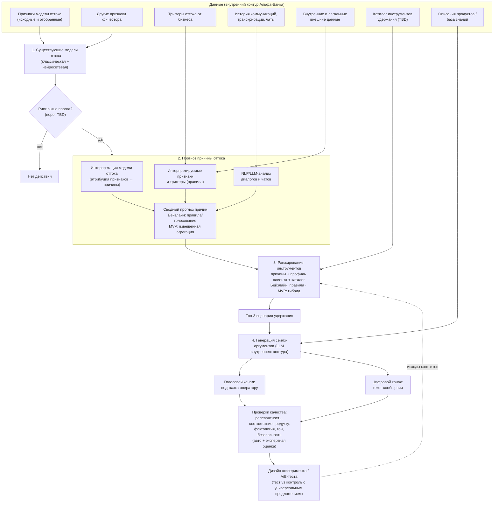

# ML System Design Doc — [RU]
## Дизайн ML-системы — ML-персонализация удержания клиентов ММБ, MVP (PoC), итерация 1

*Это начальная версия: разделы 1.1–2.2 заполнены по описанию проекта от заказчика. Всё, чего нет в описании (объёмы данных, текущие значения метрик, список инструментов удержания, сроки и т. п.), помечено как **допущение**, **TBD** или вынесено в вопросы к заказчику (раздел 3).*

> **Термины**
> - **ММБ** — микро- и малый бизнес: ИП и ООО с годовой выручкой не более 500 млн руб.
> - **Отток** — уход клиента ММБ из банка. Точное операционное определение (закрытие счёта, падение оборотов, перевод основного обслуживания в другой банк) — **TBD**, нужно согласовать с заказчиком (вопрос В1).
> - **Модель оттока** — классическая и нейросетевая модели прогноза оттока, которые уже есть в Альфа-Банке.
> - **Инструмент удержания** — продукт, условие или действие, которое предлагают клиенту, чтобы его удержать. Каталог — **TBD** (В3).
> - **Сценарий удержания** — сочетание «причина → инструмент → канал → аргумент».
> - **Сейлз-аргумент** — персональная формулировка выгоды для клиента: для голосового канала (оператор) или цифрового (текстовые коммуникации).
> - **Внутренний контур** — инфраструктура банка, где развёрнуты согласованные модели (в том числе LLM) и данные.

---

### 1. Цели и предпосылки

#### 1.1. Зачем идем в разработку продукта?

**Бизнес-цель.** Снизить процент оттока клиентов ММБ. Для этого банк хочет перейти от универсальных предложений к релевантной помощи: понять вероятную причину ухода, выбрать подходящий инструмент удержания и объяснить выгоду понятным языком в конкретном канале.

**Проблема текущего состояния.** Существующие модели оттока отвечают на вопрос «*кто* может уйти», но не на вопросы:
- *почему* клиент может уйти (вероятная причина);
- *что* предложить (какой инструмент удержания релевантен этой причине и профилю клиента);
- *как* предложить (формулировка под голосовой или цифровой канал).

Без этого удержание строится на универсальных предложениях, которые могут не попадать в реальную проблему клиента.

**Почему станет лучше с ML/LLM.**
- Интерпретация признаков модели оттока, новые интерпретируемые признаки и триггеры, анализ диалогов, транскрибаций и чатов дают сигналы о *причине*, а не только о риске.
- Ранжирование инструментов (правила, модель или гибрид) учитывает и причину, и профиль клиента и выдаёт топ-3 сценария вместо одного универсального предложения.
- LLM во внутреннем контуре генерирует персональные аргументы под канал и масштабирует персонализацию на уровень отдельного клиента, а не только сегмента.

**Что считаем успехом итерации (с точки зрения бизнеса).** Итерация исследовательская, с PoC. Успех — получены ожидаемые результаты из описания проекта:
1. Саммари мировых практик и решений конкурентов по AI-подходам к удержанию ММБ и персонализации коммуникаций.
2. Карта данных, признаков и триггеров оттока с оценкой интерпретируемости, качества и потенциальной ценности.
3. Гипотезы о причинах оттока, подтверждённые или опровергнутые на данных, и обоснованный подход к прогнозу причины.
4. Рекомендации по использованию существующих моделей, новых признаков, коммуникационных данных и внешних источников.
5. Концепция ранжирования инструментов удержания: входы, логика топ-3, ограничения.
6. PoC генерации сейлз-аргументов на моделях внутреннего контура, набор примеров и методика оценки качества для двух каналов.
7. Дизайн эксперимента или A/B-теста для проверки эффекта.
8. Итоговая документация, презентация и рекомендации на краткий, средний и долгий срок.

Снижение оттока в этой итерации **не измеряется**: эффект проверяют в последующем эксперименте по дизайну из п. 7. Целевое снижение оттока — **TBD** (В2).

#### 1.2. Бизнес-требования и ограничения

**Краткое описание БТ.**

| № | Бизнес-требование | Источник |
|---|---|---|
| БТ-1 | Для клиентов с высоким риском оттока (по существующим моделям) определять вероятную причину оттока | Описание проекта, шаг 2 |
| БТ-2 | Причина должна быть интерпретируемой и опираться на признаки модели, триггеры, коммуникации, внутренние и внешние данные; возможен сводный прогноз из нескольких источников | Шаг 2 |
| БТ-3 | По причине и данным о клиенте ранжировать доступные инструменты удержания и выделять топ-3 сценария для первичного предложения | Шаг 3 |
| БТ-4 | Для выбранных инструментов генерировать персональные сейлз-аргументы **отдельно** для голосового и цифрового каналов | Шаг 4 |
| БТ-5 | Аргументы оцениваются по критериям: релевантность клиенту, соответствие продукту, фактологическая корректность, тон коммуникации, безопасность формулировок | «Что предстоит делать» |
| БТ-6 | Нужна схема проверки эффекта: метрики и дизайн эксперимента или A/B-теста | «Что предстоит делать», «Ожидаемые результаты» |

Детальных документов с БТ на этом этапе нет: **TBD**, запросить у заказчика (В9).

**Бизнес-ограничения.**
- **Сегмент:** только ММБ — ИП и ООО с годовой выручкой не более 500 млн руб.
- **Контур:** PoC генерации строится на согласованных источниках данных и моделях, развёрнутых во **внутреннем контуре** банка. Передача клиентских данных во внешние сервисы, в том числе в публичные LLM API, не предполагается.
- **Легальность данных:** внешние данные о клиентах используются, только если они получены легальным способом.
- **Опора на существующее:** модели оттока уже есть. Новую промышленную модель оттока не строим, а дополняем существующие интерпретацией причин. Гипотезы проверяются на данных *без обязательного* построения промышленной модели причин.
- **Учёт существующих решений:** нужно изучить и учесть подходы Альфа-Банка к генерации сейлз-аргументов (Альфа-помощник оператора, Alfa Only и другие).
- **Формат работы:** команда работает самостоятельно, заказчик подключается для уточнений и решения проблемных вопросов. Значит, вопросы к заказчику (раздел 3) нужно собирать пакетами.
- **Безопасность формулировок:** сгенерированные аргументы не должны содержать некорректных фактов о продуктах и рискованных формулировок. Конкретные регуляторные и комплаенс-требования к коммуникациям — **TBD** (В7).
- Сроки, бюджет, вычислительные ресурсы и доступные LLM внутреннего контура — **TBD** (В5, В6).

**Что ожидаем от итерации.** Исследование и PoC: саммари практик, карта данных, проверенные гипотезы о причинах, концепция ранжирования топ-3, PoC генерации аргументов для двух каналов с методикой оценки, дизайн эксперимента. Промышленное внедрение в итерацию не входит.

**Описание бизнес-процесса пилота (целевое видение, уточняется).**
1. Существующие модели оттока скорят клиентов ММБ, выбираются клиенты с высоким риском. Порог и периодичность скоринга — **TBD**.
2. Для каждого клиента из выборки модуль причин выдаёт вероятные причины оттока с уверенностью и объяснением (какие признаки, триггеры или фрагменты коммуникаций на это указывают).
3. Модуль ранжирования сопоставляет причины, профиль клиента и каталог инструментов удержания и возвращает топ-3 сценария.
4. Модуль генерации готовит аргументы для выбранных сценариев:
   - **голосовой канал:** подсказка оператору или менеджеру (тезисы, ответы на возражения). Возможная интеграция с практикой Альфа-помощника оператора — гипотеза, требует проверки;
   - **цифровой канал:** короткий текст сообщения (конкретные каналы — **TBD**, В4).
5. Аргументы проходят автоматические проверки качества и безопасности. На этапе PoC добавляется экспертная оценка.
6. Результат контакта (принял или отклонил предложение, остался клиент или ушёл) фиксируется и используется для оценки эффекта и обратной связи.

Режим генерации (batch, заранее по выборке, или online, в момент контакта) — открытый вопрос исследования. В PoC по умолчанию предполагаем **batch** как более простой и контролируемый вариант (допущение).

**Критерии успешного пилота и пути развития.**
- *PoC (эта итерация):* гипотезы о причинах проверены на данных с явными выводами «подтверждена / опровергнута / недостаточно данных». Аргументы PoC проходят оценку по пяти критериям БТ-5. Целевые пороги — **TBD**, согласуются с заказчиком при разработке методики. Дизайн эксперимента согласован с заказчиком.
- *Пилот (следующие итерации):* в A/B-тесте статистически значимое улучшение целевой метрики удержания в группе персональных сценариев по сравнению с контрольной группой с текущим (универсальным) подходом. Целевая метрика и MDE — **TBD**.
- *Развитие:* рекомендации на краткий, средний и долгий срок. Например: интеграция причин в существующие модели, переход к online-генерации, расширение каталога инструментов, обучение ранжирования на результатах экспериментов.

#### 1.3. Что входит в скоуп проекта/итерации, что не входит

**Входит в скоуп (на закрытие каких БТ подписываемся).**

| Блок | Что делаем | БТ |
|---|---|---|
| Исследование практик | Саммари мирового опыта и практик прямых конкурентов в работе с оттоком ММБ с AI/ML; персонализация на уровне сегмента и клиента; batch vs online; применимость к ММБ; применимые в Альфа-Банке решения | БТ-1…БТ-4 |
| Анализ данных | Признаки существующей модели (исходные и отобранные), другие признаки фичестора, триггеры от бизнеса, история коммуникаций, транскрибации, чаты, внутренние и легальные внешние данные → карта данных с оценкой интерпретируемости, качества и ценности | БТ-1, БТ-2 |
| Причина оттока | Гипотезы о причинах и сигналах, их проверка на данных, подход к прогнозу причины (в т. ч. сводный), ограничения, риски смещений, требования к валидации | БТ-1, БТ-2 |
| Ранжирование | Концепция сопоставления «причина + профиль → инструмент»; правила, модель или гибрид для топ-3; ограничения | БТ-3 |
| Генерация аргументов | Изучение подходов Альфа-Банка (Альфа-помощник оператора, Alfa Only и др.); PoC во внутреннем контуре; варианты для голосового и цифрового каналов; набор примеров; методика оценки качества | БТ-4, БТ-5 |
| Эксперимент | Метрики эффективности и дизайн эксперимента или A/B-теста | БТ-6 |
| Документация | Итоговая документация, презентация, рекомендации на краткий, средний и долгий срок | все |

**Не входит в скоуп итерации.**
- Переобучение или замена существующих классической и нейросетевой моделей оттока. Даём только рекомендации по ним.
- Промышленная модель прогноза причин и промышленный сервис ранжирования или генерации. Делаем исследование и PoC.
- Интеграция в боевые системы и каналы коммуникации (CRM, рабочее место оператора, рассылки).
- Проведение A/B-теста и измерение фактического эффекта на отток. Готовим только дизайн.
- Создание новых инструментов удержания и изменение продуктовых условий. Работаем с доступным каталогом.
- Сегменты вне ММБ (крупный бизнес, физлица).

**Качество кода и воспроизводимость.**
- Код исследований и PoC хранится в этом репозитории. Окружение фиксируется через `uv` (`pyproject.toml`, `uv.lock`), стиль контролируют `ruff` и `pre-commit`.
- Ноутбуки EDA и проверки гипотез воспроизводимы на согласованных выгрузках внутри контура банка. Клиентские данные в публичный репозиторий **не попадают**: в репозитории только код, конфиги, синтетические или обезличенные примеры и документация.
- Промпты, версии моделей и наборы примеров для оценки аргументов версионируются.

**Планируемый технический долг.**
- Пайплайны PoC не оптимизированы под промышленную нагрузку и SLA.
- Ранжирование топ-3 в первой версии может быть rule-based или экспертным, без обучения на исходах удержания (их ещё нет).
- Оценка качества аргументов частично ручная (экспертная разметка), автоматизация (LLM-as-a-judge, правила) — частичная.
- Нет мониторинга дрейфа и online-инференса.

#### 1.4. Предпосылки решения

- **Риск оттока** берём из существующих классической и нейросетевой моделей. Их качество и калибровку на этапе PoC считаем достаточными (допущение, проверяем при анализе данных).
- **Причины оттока** — многоклассовая или multi-label сущность: у клиента может быть несколько причин. Таксономию причин формируем из триггеров бизнеса, анализа коммуникаций и мирового опыта и согласуем с заказчиком (В8). Размеченного таргета «причина» в данных, вероятно, **нет** (допущение). Отсюда ставка на интерпретацию, слабую разметку (weak supervision) по коммуникациям и экспертную валидацию.
- **Блоки данных:** признаки существующей модели оттока; другие признаки фичестора; триггеры от бизнеса; история коммуникаций, транскрибированные разговоры, чаты; внутренние и легальные внешние данные о клиенте. Доступность и качество каждого блока проверяем при анализе данных (раздел 2.3, следующая итерация).
- **Гранулярность:** клиент ММБ (ИП или ООО), допущение. Нужно уточнить, как учитывать связанные компании и несколько счетов.
- **Горизонт прогноза и момент среза** наследуем от существующих моделей оттока: **TBD** (В1).
- **Каталог инструментов удержания** и ограничения их применимости (кому можно предлагать) получаем от бизнеса: **TBD** (В3).
- **Модели генерации:** только LLM, развёрнутые во внутреннем контуре и согласованные с банком. Какие именно доступны — **TBD** (В6).
- **Каналы:** голосовой (оператор или менеджер) и цифровой. Требования к формату (длина, стиль, допустимые элементы) различаются и задаются отдельно.

---

### 2. Методология

#### 2.1. Постановка задачи

Система — каскад из четырёх подзадач. Две первые прогнозные, третья рекомендательная, четвёртая генеративная.

| № | Подзадача | Тип задачи | Вход | Выход |
|---|---|---|---|---|
| 1 | Выявление клиентов с риском оттока | Бинарная классификация (**существующие модели**, не разрабатываем) | Признаки клиента | Вероятность оттока, отбор по порогу |
| 2 | Прогноз вероятной причины оттока | Multi-label классификация или атрибуция причин. Комбинация: интерпретация модели оттока (например, SHAP-значения с маппингом признаков на причины), правила-триггеры, NLP-классификация коммуникаций (в т. ч. LLM zero/few-shot), агрегация в сводный прогноз | Признаки, триггеры, коммуникации, внутренние и внешние данные | Ранжированный список причин с уверенностью и объяснением |
| 3 | Ранжирование инструментов удержания | Задача ранжирования / рекомендаций. Бейзлайн — правила «причина → инструмент» с фильтрами применимости; развитие — модель или гибрид (в т. ч. uplift-подход, когда появятся исходы экспериментов) | Причины, профиль клиента, каталог инструментов | Топ-3 сценария |
| 4 | Генерация сейлз-аргументов | Условная генерация текста LLM во внутреннем контуре (промптинг с подстановкой фактов о клиенте и продукте, по возможности с опорой на базу знаний о продуктах — RAG) | Сценарий, факты о клиенте, описание продукта, канал | Аргумент для голосового и для цифрового канала |

**Метрики (предварительно, пороги — TBD).**
- *Причины:* согласие с экспертной разметкой на валидационной выборке (precision/recall@k по причинам), стабильность объяснений, покрытие (доля клиентов с определённой причиной).
- *Ранжирование:* офлайн — доля случаев, когда эксперт считает релевантным хотя бы один из топ-3 (hit@3); в эксперименте — принятие предложения и удержание.
- *Генерация:* пять критериев БТ-5 по шкале экспертной оценки и (где возможно) автоматические проверки: соответствие фактов входным данным, отсутствие запрещённых формулировок, ограничения формата канала.
- *Бизнес (в эксперименте):* доля удержанных клиентов из группы риска, отклик на предложение — по сравнению с контрольной группой. Определение и окно измерения — **TBD**.

**Риски и ограничения методологии.**
- Атрибуции модели оттока объясняют *модель*, а не причинно-следственную связь. Интерпретации нужно валидировать экспертами и коммуникациями.
- Смещения: коммуникации есть не у всех клиентов, обратившиеся клиенты систематически отличаются от остальных. Возможно смещение по подсегментам ММБ (ИП и ООО, разная выручка).
- Галлюцинации LLM: факты о продуктах и клиенте должны браться только из переданного контекста, нужны проверки фактологии.
- Без исходов экспериментов ранжирование нельзя обучить на эффекте. Первая версия экспертная, эффект проверяется в A/B-тесте.

#### 2.2. Блок-схема решения

Бейзлайн и MVP различаются наполнением блоков, а не архитектурой, поэтому схема одна. Различия указаны в подписях.

#### 2.3. Этапы решения задачи (план, детализируется после EDA)

По шаблону раздел 2.3 детально заполняется **по результатам EDA**. Ниже — план этапов текущей итерации:

1. **Исследование практик:** мировой опыт и конкуренты (отток ММБ, персонализация, batch vs online), существующие решения Альфа-Банка (Альфа-помощник оператора, Alfa Only и др.).
2. **Подготовка и анализ данных:** карта данных, признаков и триггеров. Таблицы целевых переменных и признаков по шаблону — после получения доступа.
3. **Причины оттока:** таксономия причин, гипотезы, проверка на данных, сводный прогноз, риски смещений, требования к валидации.
4. **Ранжирование:** концепция топ-3 (входы, логика, ограничения).
5. **PoC генерации:** промпты и пайплайн во внутреннем контуре, примеры для двух каналов, методика оценки качества.
6. **Дизайн эксперимента:** метрики, группы, размер выборки, длительность.
7. **Итоговый отчёт:** документация, презентация, рекомендации на краткий, средний и долгий срок.

---

### 3. Открытые вопросы к заказчику

| № | Вопрос |
|---|---|
| В1 | Операционное определение оттока ММБ, горизонт прогноза и момент среза в существующих моделях; их текущее качество |
| В2 | Текущий уровень оттока ММБ и целевое снижение (бизнес-KPI проекта) |
| В3 | Каталог доступных инструментов удержания и правила их применимости и ограничения (стоимость, кому можно предлагать) |
| В4 | Какие конкретно голосовые и цифровые каналы используются для удержания ММБ, требования к формату сообщений |
| В5 | Сроки итерации и пилота, доступные ресурсы и вычислительные мощности |
| В6 | Какие LLM и инструменты доступны во внутреннем контуре; доступ к документации по Альфа-помощнику оператора и Alfa Only |
| В7 | Регуляторные и комплаенс-требования к содержанию коммуникаций и использованию данных (в т. ч. транскрибаций и внешних данных) |
| В8 | Перечень триггеров оттока от бизнеса и есть ли исторически зафиксированные причины ухода (например, по опросам или обращениям) |
| В9 | Детальные документы с бизнес-требованиями и критерии приёмки PoC |
