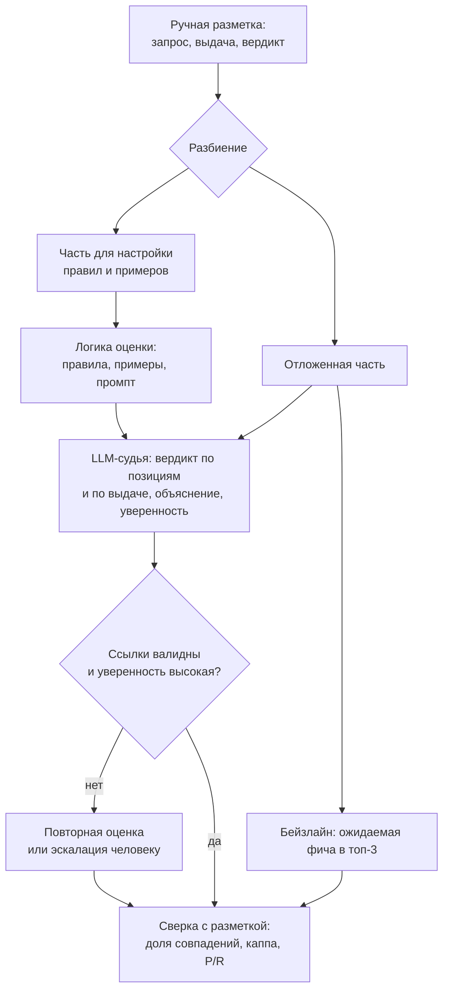
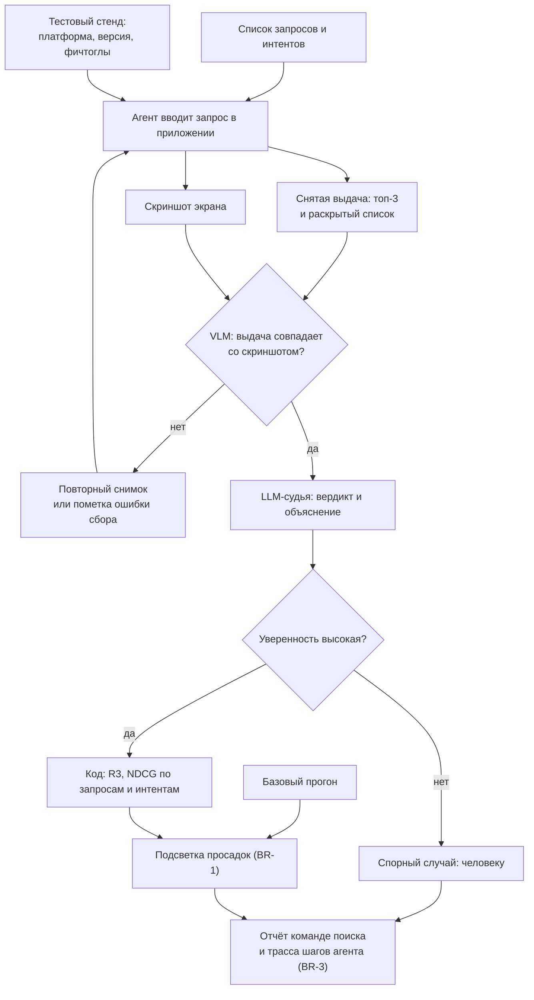

# ML System Design Doc — [RU]

## Дизайн ML-системы: AI-оценщик поисковой выдачи Альфа-Онлайн и Альфа-Мобайл, MVP, итерация 1

*Документ составлен по структуре [шаблона ML System Design Doc от Reliable ML](https://github.com/IrinaGoloshchapova/ml_system_design_doc_ru/blob/main/ML_System_Design_Doc_Template.md). Источники: описание кейса «Автоматизация тестирования с помощью ИИ» (Альфа-Банк) и [BRD «Тестирование выдачи умного поиска»](brd.md). Всё, чего нет в этих материалах, помечено как **допущение** или **TBD** и вынесено в вопросы к заказчику (раздел 3).*

> **Статус согласования.** Ответов заказчика на наши вопросы пока нет. Поэтому пороги, формат разметки, доступы к моделям и стенду описаны как допущения. Документ дополним после ответов и после получения первой разметки (не раньше 16.11.2026).
>
> **Данные.** Данных банка у команды пока нет. EDA для раздела 2.3 выполнен на публичных **прокси-датасетах** (WANDS, ESCI LLM-judged, banking77_ru, synthetic-search-queries-ru) и на синтетическом каталоге фич, с явной пометкой «прокси до получения данных банка»: [ноутбук](../notebooks/eda.ipynb), [отчёт](../reports/eda/README.md). После получения разметки EDA повторяем на реальных данных тем же ноутбуком.

> **Термины**
> - **Фича** — функция или продукт банка в приложении: кредит наличными, заправки, переводы.
> - **Выдача** — упорядоченный список фич, который приходит в ответ на поисковый запрос.
> - **Интент** — цель клиента, за которой стоит группа запросов, например «вклады».
> - **Топ-3** — результаты, которые клиент видит без раскрытия списка.
> - **Точка** — один размеченный пример: запрос, выдача, вердикт, объяснение.
> - **Эталон (ground truth)** — ручная разметка, которую считаем правдой.
> - **R3** — сколько из топ-3 релевантны интенту.
> - **NDCG** — насколько высоко в выдаче стоят самые релевантные фичи.
> - **CTR3** — на что из топ-3 кликнули и насколько это правильно.
> - **Классификатор** — модель банка, которая подбирает фичи к запросу. Это объект тестирования, а не часть нашей системы.
> - **Фичтогл** — переключатель, который включает фичу не всем клиентам.
> - **AlfaGen** — внутренняя платформа банка с языковыми моделями.
> - **LLM-судья** — языковая модель, которая выносит вердикт о релевантности выдачи по заданным правилам.

### 1. Цели и предпосылки

#### 1.1. Зачем идем в разработку продукта?

**Бизнес-цель.** Снять с команды поиска часть ручной проверки выдачи и быстрее находить просадки качества поиска в «Альфа-Онлайн» и «Альфа-Мобайл».

**Проблема сейчас:**
- Клиент без раскрытия списка видит только три результата, поэтому релевантная фича обязана попадать в топ-3.
- Выдачу проверяют люди вручную. Кейсов много, поэтому смотрят выборочно, и часть запросов не проверяется совсем.
- Просадки замечают с опозданием. Когда в поиск добавляют новые фичи, классификатор может деградировать на старых запросах, и нужная фича съезжает ниже.

**Почему станет лучше с ML.** Правилами типа «точное совпадение заголовка» релевантность не оценить: клиенты формулируют запросы по-разному («вклад» и «депозит»), а релевантными могут быть несколько фич. LLM-судья оценивает смысловое соответствие выдачи интенту так, как это делает разметчик, но на всём наборе запросов и после каждого релиза. Ручная проверка остаётся для спорных случаев, которые система сама передаёт человеку.

**Успех итерации для бизнеса.** Критерий успеха из BRD — доля совпадений вердиктов системы с ручной разметкой. Целевой порог — **TBD** (вопрос В4). Кроме того, итерация успешна, если на демонстрации команда поиска видит по каждому запросу вердикт с объяснением, метрики и подсвеченные просадки, а также может пройти по шагам работы агента.

#### 1.2. Бизнес-требования и ограничения

**Бизнес-требования (из BRD):**

| № | Требование |
| --- | --- |
| BR-1 | Подсвечивать запросы, которые просели, в том числе когда нужная фича съехала ниже |
| BR-2 | Собирать выдачу по каждому запросу с учётом платформы и версии. Главное — верхние 3 позиции |
| BR-3 | Флоу работы агента виден: его можно посмотреть по шагам и оценить логику |
| BR-4 | По каждой выдаче даётся вердикт с объяснением. Ground truth — разметка |

**Целевой пользователь** — команда поиска. Она получает подсветку просадок и решает, на что обратить внимание.

**Бизнес-ограничения:**
- **Модели.** Используем LLM и VLM платформы AlfaGen. Можно ли использовать внешние или локально развёрнутые модели — **TBD** (В5). Для разработки команда может развернуть VLM на своей GPU с 24 ГБ видеопамяти, если банк это разрешит.
- **Данные.** Запросы, выдача и разметка — внутренние данные банка. Передавать их во внешние сервисы без согласования нельзя.
- **Среда.** Прогоны выполняются на тестовом стенде банка. Состояние фичтоглов влияет на выдачу: фича под выключенным тогглом не покажется, и это даст ложную «просадку». Как управлять тогглами — **TBD** (В7).
- **Разметка.** Первая разметка от команды Альфа-Банка придёт не раньше 16.11.2026. Сроки полной разметки (50–100 кейсов на интент) не определены. До первой разметки калибровка возможна только на синтетических примерах.
- **Проверяемость.** Вывод агента нельзя принимать на веру. Каждый вердикт должен ссылаться на позиции выдачи и интент, а неуверенные вердикты должны уходить человеку.
- **Скоуп.** Нужен не универсальный тестировщик, а согласованный контур: поисковая выдача.

**Что ожидаем от итерации.** Работающий оценщик, откалиброванный на разметке, с измеренной долей совпадений. Прототип рабочего прогона хотя бы на одной платформе. Демонстрация команде поиска.

**Как система встраивается в процесс.** Сейчас разметчик вручную вбивает запрос, смотрит выдачу и решает, корректна ли она. В пилоте ручная проверка не отключается:
1. Команда поиска задаёт список запросов и интентов. Разметчики размечают эталон.
2. После релиза или по расписанию (частота — **TBD**, В6) система прогоняет запросы на стенде, выносит вердикты, считает метрики и сравнивает их с базовым прогоном.
3. Команда поиска получает отчёт: подсвеченные запросы, вердикты с объяснениями, трассу шагов агента. Спорные случаи разметчик проверяет вручную.

**Успешный пилот и развитие.** Пилот успешен, если доля совпадений с ручной разметкой не ниже согласованного порога, а система находит реальные просадки при смене версии без большого числа ложных срабатываний. Пути развития: глубокая проверка карточки фичи (агент открывает её, а VLM сверяет экран с интентом), синтетические профили клиентов разных архетипов, расширение на iOS и web, встраивание в CI релизов.

#### 1.3. Что входит в скоуп проекта/итерации, что не входит

**Входит в итерацию:**
- **Этап 1 BRD — калибровка оценщика.** Логика оценки на первых примерах, вердикты по полному набору «запрос и выдача», сверка с ручной разметкой и подсчёт доли совпадений.
- **Этап 2 BRD — рабочий прогон.** Агент вводит запросы в приложении на тестовом стенде, снимает выдачу с учётом платформы и версии (BR-2), оценивает её (BR-4), считает R3 и NDCG и подсвечивает просадки (BR-1).
- **Трасса агента (BR-3).** Для каждого запроса сохраняются шаги: ввод, снятая выдача, скриншот, промпт и ответ судьи, итоговый вердикт.
- **Самопроверка.** Привязка вердикта к позициям выдачи и интенту, повторная оценка спорных случаев, фиксация уверенности, эскалация человеку.
- **Обзор практик AI- и агентного тестирования** — как вход для выбора подхода, из описания кейса.
- **Демонстрация команде поиска (этап 3 BRD).**

**Не входит:**
- Универсальный тестировщик для любых продуктов банка.
- Изменение самого классификатора поиска. Мы его тестируем, а не дообучаем.
- Глубокая проверка карточек (что открывает фича), синтетические профили клиентов и поиск фич без поисковой строки. Это наши предложения из раздела 6 вопросов к заказчику, они пойдут в следующие итерации, если заказчик их согласует.
- Обязательная поддержка iOS и web. Стартуем с одной платформы, по умолчанию Android (**допущение**, В3). Вторая платформа — дополнительный трек.
- CTR3 по реальным кликам, пока нет источника продовой аналитики (В8).
- Продовая эксплуатация: SLA, мониторинг, интеграция в TestOps.

**Качество кода и воспроизводимость:** репозиторий с Ruff и pre-commit; зафиксированные версии промптов и логики оценки; набор тестовых заданий и артефактов для воспроизводимой оценки; каждый прогон сохраняется с платформой, версией приложения и версией оценщика.

**Технический долг, который осознанно откладываем:** инфраструктура для регулярных прогонов (CI или планировщик), веб-дашборд вместо статического отчёта, поддержка матрицы версий.

#### 1.4. Предпосылки решения

- **Единица оценки** — пара «запрос и выдача» на конкретной платформе и версии. Основной фокус — топ-3, раскрытый список снимаем для диагностики просевших фич (**допущение**, В2).
- **Эталон** — ручная разметка команды поиска. Её формат (бинарная релевантность позиций или вердикт по выдаче целиком, шкала) — **TBD** (В1). До ответа проектируем оценщик так, чтобы он выдавал и оценку каждой позиции топ-3, и вердикт по выдаче целиком.
- **Источники данных:**

| Блок | Что это | Зачем |
| --- | --- | --- |
| Список запросов и интентов | Частые запросы, сгруппированные по интентам, 50–100 кейсов на интент | Вход прогона |
| Ручная разметка | Запрос, выдача, вердикт, объяснение | Эталон для калибровки и оценки |
| Каталог фич | Название, описание и, при наличии, диплинк фичи | Контекст для судьи: чем фича является |
| Выдача на стенде | Упорядоченный список фич и скриншот экрана | Объект оценки |
| Базовый прогон | Метрики предыдущей версии или прошлого прогона | Сравнение для поиска просадок |

- **Горизонт и частота.** Прогноза нет. Система оценивает текущее состояние выдачи. Прогон запускается по релизу или по расписанию (**TBD**, В6).
- **Просадка (допущение до ответа на В6).** Ожидаемая фича интента выпала из топ-3, либо NDCG@3 запроса упал относительно базового прогона больше порога (по EDA τ = 0,2), либо средний ΔNDCG@3 по набору ниже порога релиза. Пороги уточняем на разметке.
- **Модели.** Готовые LLM и VLM без дообучения. Качество достигается правилами оценки в промпте, примерами из разметки и самопроверкой.
- **Метрики R3 и NDCG** считает детерминированный код по вердиктам позиций. LLM метрики не считает: так их можно воспроизвести и проверить.

### 2. Методология

#### 2.1. Постановка задачи

**Техническая задача** — оценка релевантности поисковой выдачи с помощью LLM-судьи (LLM-as-a-judge) плюс агент, собирающий выдачу в интерфейсе. Это не задача ранжирования: мы не строим поиск, а проверяем, насколько выдача классификатора соответствует интенту запроса.

**Компоненты:**
1. **Сборщик выдачи (этап 2).** Агент вводит запрос в приложении на стенде (Appium для мобильного приложения или Playwright для web) и снимает упорядоченный список фич. VLM сверяет снятый список со скриншотом экрана, чтобы не оценивать ошибку парсинга вместо ошибки поиска.
2. **LLM-судья.** На вход: запрос, интент, топ-3 (и раскрытый список), описания фич из каталога, правила оценки, примеры из разметки. На выход: релевантность каждой позиции, вердикт по выдаче, объяснение со ссылками на позиции, уверенность.
3. **Самопроверка.** Структурированный ответ проверяется: каждая позиция, на которую ссылается объяснение, должна существовать в выдаче, а фича — в каталоге. При низкой уверенности или расхождении повторных прогонов судьи (другая формулировка, другая модель) случай помечается спорным и уходит человеку.
4. **Метрики и просадки.** Код считает R3 и NDCG по запросу и интенту, сравнивает с базовым прогоном и подсвечивает просевшие запросы.
5. **Трасса и отчёт.** Для каждого запроса доступны все шаги агента (BR-3).

**Бейзлайн:** правило без ML — «вердикт положительный, если ожидаемая фича интента из разметки есть в топ-3 по точному совпадению названия». Бейзлайн не понимает синонимов и не оценивает несколько релевантных фич, поэтому ожидаем, что LLM-судья совпадёт с разметкой чаще.

**Метрики:**
- **Качество оценщика (главная, критерий BRD).** Доля совпадений вердиктов с ручной разметкой (accuracy), а также каппа Коэна, чтобы учесть случайное совпадение. Precision и recall по классу «выдача некорректна», потому что пропущенная просадка и ложная тревога стоят по-разному.
- **Качество сборщика.** Доля запросов, где снятая выдача совпала с экраном (сверка со скриншотом).
- **Качество поиска (то, что отдаём команде поиска).** R3 и NDCG@3 по запросам и интентам. CTR3 — только при появлении источника кликов (В8).
- **Поиск просадок.** Доля найденных искусственно внесённых просадок (переставляем фичи в зафиксированной выдаче) и доля ложных срабатываний.
- **Стоимость.** Время и стоимость прогона на один запрос в сравнении с ручной проверкой. Доля случаев, ушедших человеку.

**Оценка.** Этап 1: размеченный набор делим на часть для настройки правил и примеров в промпте и отложенную часть для итогового замера доли совпадений. Этап 2: прогон на двух версиях приложения или на зафиксированной выдаче с внесёнными просадками.

#### 2.2. Блок-схема решения

**Этап 1. Калибровка оценщика на размеченных данных**

**Этап 2. Рабочий прогон**

#### 2.3. Этапы решения задачи

> Это **этапы разработки**, то есть порядок, в котором мы строим систему. Флоу BRD («проверка оценки», «рабочий прогон», «демонстрация») описывает работу готовой системы.
>
> **Цифры получены на прокси.** Данных банка пока нет. Все числа ниже — из EDA на открытых датасетах ([ноутбук](../notebooks/eda.ipynb), [отчёт](../reports/eda/README.md)): каталог фич (48 карточек, **допущение**) с запросами banking77_ru и synthetic-search-queries-ru — покрытие; WANDS — выдача и просадки; ESCI LLM-judged — согласие LLM-судьи с людьми. На разметке банка выводы перепроверяем тем же ноутбуком.

**Сводка этапов**

| № | Этап | Вход | Результат | Срок |
| --- | --- | --- | --- | --- |
| 1 | Подготовка данных | Запросы, каталог фич, разметка | Проверочный набор v1, EDA на данных банка | Первая разметка — не раньше 16.11.2026; сроки полной разметки не определены |
| 2 | Прогнозные модели: бейзлайны и LLM-судья | Набор из этапа 1, доступ к AlfaGen | Судья v1, замер против бейзлайнов | После полной разметки, **TBD** |
| 3 | Самопроверка и эскалация | Судья v1 | Порог эскалации человеку | Вместе с этапом 2 |
| 4 | Сборщик выдачи | Тестовый стенд, сборки Android | Выдача с платформой, версией, скриншотом | **TBD** (В3, В7) |
| 5 | Метрики и детектор просадок | Вердикты двух прогонов | Подсвеченные запросы (BR-1) | После этапов 2 и 4 |
| 6 | Трасса агента и отчёт | Логи этапов 2–5 | Отчёт с трассой (BR-3) | Параллельно этапам 4–5 |
| 7 | Демонстрация и пилот | Всё выше | Демо, отчёт, рекомендации | **TBD** (В9) |

##### Этап 1. Подготовка данных

**Единица оценки — точка:** запрос, интент, платформа, версия, выдача, оценки позиций, вердикт, объяснение.

*Целевые переменные*

| Данные | Есть в компании | Источник | Качество проверено |
| --- | --- | --- | --- |
| Оценка каждой позиции: 2 — целевая, 1 — смежная, 0 — нерелевантная (**допущение**) | Частично, формат **TBD** (В1) | Разметчики команды Альфа-Банка | Нет |
| Вердикт по выдаче (`ok` / `not_ok`) и объяснение | Частично | Там же | Нет |
| Ожидаемая фича интента | **TBD** | Команда поиска | Нет |

*Признаки*

| Данные | Есть в компании | Источник | Качество проверено |
| --- | --- | --- | --- |
| Частые запросы по интентам | Да, источник **TBD** | Команда поиска | Нет |
| Каталог фич: название, описание, диплинк | Да (**допущение**) | Команда поиска | Нет |
| Выдача на стенде и скриншот | Нет, снимает наш сборщик (этап 4) | Мы, доступ к стенду | Нет |
| Платформа, версия, фичтоглы | Да | QA/DevOps банка | Нет |
| Базовый прогон | Нет, после первого прогона | Мы | — |

**Выводы EDA и решения**

| Наблюдение на прокси | Решение |
| --- | --- |
| Нет открытого датасета «банк + русский язык + пары запрос–фича» | Выводы — гипотезы, проверяем на первой разметке банка |
| Открытые запросы перекошены: на кредиты 12 фраз, на сбережения 25, у 2 карточек ни одной | Набор собираем с командой Альфа-Банка по квоте на каждый раздел: ~410 запросов, 15–58 на раздел |
| Лексический бейзлайн: NDCG@3 0,71 на чистых запросах, 0,65 с опечаткой, 0,12 при неверной раскладке | Обязательные страты «опечатка», «раскладка», «вне каталога» (~10% каждая), метрики по стратам |
| Правильный ответ не один: R3 одной выдачи 0,88 со смежными позициями и 0,40 без них | Шкала 0/1/2 и метка «подходящей фичи нет»; основная метрика NDCG@3, R3 в двух вариантах |
| Согласие людей между собой в прокси не измерено | Двойная разметка ~15% запросов (не меньше 60) — потолок для судьи |

**Процесс получения данных**
- **Запросы:** таблица `query, intent` от команды поиска, источник **TBD**. Обновляется при добавлении фич.
- **Разметка:** разметчики вводят запрос, смотрят выдачу, ставят вердикт. Первая часть — не раньше 16.11.2026, она идёт только в dev. Сроки полной разметки не определены. Ожидаемый формат: строка на позицию выдачи (`run_id, platform, app_version, query, intent, position, feature, relevance, verdict, explanation`), загрузчик `load_bank_serp` готов.
- **Выдача:** до этапа 4 — из разметки, после — от сборщика, с `run_id`, версией, фичтоглами и скриншотами.
- **Каталог фич:** выгрузка от команды поиска, версионируется.

**Если данных не хватит**
- **Минимум — 400 запросов.** Релиз, сломавший 10% запросов, ловится с вероятностью 0,79 при 300 запросах и 0,83 при 400. Требование BRD «50–100 кейсов на интент» сохраняем для частых интентов.
- **Если разметки меньше:** итоговый замер только по общей отложенной части; человеку в первую очередь — спорные случаи судьи; LLM-перефразы и опечатки — только для проверки устойчивости, не для итоговой метрики.
- **До разметки** код отлаживаем на прокси.

**Конфиденциальность**
- Персональные данные в запросах (карты, телефоны, email) маскируем до отправки в LLM.
- Модели — только в периметре банка (AlfaGen); локальная VLM — с разрешения банка (В5).
- Прогоны на тестовом стенде с тестовыми аккаунтами. Данные банка не попадают в git (`data/raw/` в `.gitignore`).

**Результат этапа:** проверочный набор v1 с разбиением dev/отложенная часть; поднабор с двойной разметкой и согласие человек–человек; EDA на данных банка; согласованные шкала, рискованные пары интентов и ожидаемые фичи.

##### Этап 2. Подготовка прогнозных моделей: бейзлайны и LLM-судья

**Прогнозная модель — оценщик выдачи.** По запросу и выдаче он предсказывает оценки позиций и вердикт, как разметчик. LLM не дообучаем: настраиваем правила, промпт и примеры на dev.

**ML-метрики**

| Метрика | Зачем |
| --- | --- |
| Accuracy вердикта против разметки | Главная, критерий успеха BRD |
| Каппа Коэна по вердикту, взвешенная каппа по позициям | Поправка на дисбаланс классов |
| Recall и precision по `not_ok` | Пропуск и ложная тревога стоят по-разному |
| MAE NDCG@3 и согласие R3 (судья против разметки) | Команде поиска отдаём именно эти метрики |
| Согласие человек–человек | Потолок: цель — каппа судьи не ниже потолка минус запас (**TBD**, В4) |
| Brier score уверенности | На уверенности держится эскалация |
| Время и стоимость на точку | Сравнение с ручной проверкой |

**Функция потерь.** Градиентного обучения нет. Промпт, примеры и модель выбираем по каппе на dev. Порог эскалации — по стоимости ошибок: `cost = c_miss × пропуски + c_false × ложные тревоги + c_human × эскалации`. До согласования пропуск в 3 раза дороже ложной тревоги (**допущение**).

**Схема валидации**
- Делим по нормализованному тексту запроса, чтобы дубли не утекли между частями.
- Стратифицируем по интенту, длине запроса, стратам шума и платформе.
- Первая разметка — целиком в dev. Полный набор: 30% dev, 70% отложенная часть (**допущение**). Отложенную часть смотрим один раз на версию судьи.
- Отдельно проверяем интенты, которых нет в промпте (leave-intent-out), и каталог с новыми фичами.
- Пары берём из реальной выдачи: на ESCI на них судья точнее (0,665 против 0,544 на случайных парах).
- 3 повтора при температуре 0; доверительные интервалы — бутстреп по запросам.

**Бейзлайны**
- **Б0:** `ok`, если ожидаемая фича в топ-3 по точному совпадению названия.
- **Б1:** TF-IDF по символьным n-граммам между запросом и фичей, пороги на dev. На каталоге: NDCG@3 0,71 на чистых запросах, 0,12 при неверной раскладке.
- **Б2 (опционально):** то же на эмбеддингах открытой модели, если банк разрешит (В5).

**Прокси судьи (ESCI LLM-judged).** 1 500 пар, судья `claude-haiku-4-5` вслепую против людей. Наш судья будет на AlfaGen; это ориентир шума:
- шкала 0/1/2: accuracy 0,625, κ 0,39; «релевантно / нет»: 0,823, κ 0,40;
- 22–26% ошибок на границе 1 ↔ 2, хуже всего на однословных запросах (0,55);
- в детекторе precision тревог 0,15 без кэша и 0,30 с кэшем; при 10% ошибок — 0,39 и 0,64.

*Решения:* судью калибруем на разметке команды Альфа-Банка; к автоматическим тревогам допускаем при ошибке по позиции не выше 5–10%; правила «смежная = 1 или 0» пишем в промпт; короткие запросы и спорные оценки 1 ↔ 2 — человеку.

**MVP судьи**
- **Вход:** запрос, интент, выдача, описания фич, правила, примеры из dev.
- **Выход (JSON):** оценки позиций, вердикт, объяснение со ссылками на позиции, уверенность.
- **Предобработка:** маскирование ПДн, регистр и «ё», пометка неверной раскладки.
- **Порядок:** промпт на первой разметке → разбор расхождений на dev → выбор модели AlfaGen → один замер на отложенной части против Б0 и Б1.

**Развитие:** каскад дешёвой и сильной модели; подбор примеров kNN по dev; попарное сравнение вместо поточечного; словарь синонимов команды поиска.

**Анализ ошибок:** матрица ошибок по интентам и стратам; расхождения делим на ошибки судьи, ошибки разметки, неоднозначные запросы и пробелы каталога; 50 объяснений проверяет человек.

**Риски**

| Риск | Снижение |
| --- | --- |
| Шумная разметка | Двойная разметка, цель относительно потолка человек–человек |
| Разметки мало, сроки полной разметки не определены | Первая разметка только в dev, код отлаживаем на прокси |
| Нет доступа к AlfaGen (В5) | Пайплайн не привязан к модели |
| Переобучение промпта на dev | Замороженная отложенная часть, leave-intent-out |
| Недетерминированность | Температура 0, 3 повтора, расхождение → эскалация |
| Смещение к первой позиции | Перестановка позиций на части dev |

**Результат этапа:** версия судьи (промпт, правила, модель); отчёт на отложенной части против Б0 и Б1 по интентам и стратам; рабочая точка по `not_ok`. Команда поиска просматривает 30–50 расхождений и подтверждает логику оценки.

##### Этап 3. Самопроверка и эскалация

- **Проверки:** ссылки на позиции и фичи существуют; вердикт следует из оценок (целевая фича вне топ-3 → не `ok`).
- **Уверенность:** самооценка модели и согласие трёх повторов, калибровка по Brier score.
- **Человеку уходят:** противоречивые ответы, невалидные ссылки, низкая уверенность, «неоднозначно».
- **Метрики:** доля галлюцинаций, доля эскалаций, accuracy на остальных. Порог — по стоимости из этапа 2.
- **Бейзлайн:** судья v1 без самопроверки.

##### Этап 4. Сборщик выдачи в интерфейсе

- **Платформа:** сначала Android на тестовом стенде (**допущение**, В3).
- **Бейзлайн:** сценарий Appium с жёсткими локаторами: ввод запроса, чтение списка, скриншот.
- **MVP:** плюс VLM сверяет список со скриншотом и читает его, если локаторы сломались.
- **Сохраняем:** платформу, версию, фичтоглы (В7), выдачу, скриншоты, лог.
- **Метрики:** совпадение с ручной проверкой на 50 запросах, доля успешных прогонов, время.
- **До доступа к стенду** VLM проверяем на [ScreenSpot-v2](https://huggingface.co/datasets/OS-Copilot/ScreenSpot-v2) (в этом ДЗ не запускаем).
- **Риски:** нестабильный стенд, смена UI, выключенные фичтоглы. Снижение: повторы, проверка тогглов, сверка VLM.

##### Этап 5. Метрики выдачи и детектор просадок

- **Метрики:** R3 и NDCG@3 по запросу и интенту считает код (`src/mlsd_course/eda/ranking.py`). CTR3 — на симулированных кликах, пока нет логов (В8).
- **Симуляция релизов на WANDS:** нейтральный релиз меняет топ-3 у 84% запросов, но средний NDCG@3 не двигается (−0,001). Вытеснение релевантной позиции даёт ΔNDCG@3 от −0,33 до −0,61 и ловится в 65–82% случаев; перестановки внутри топ-3 почти неотличимы от шума.
- **Тревога по запросу:** целевая фича выпала из топ-3 или ΔNDCG@3 ≤ −0,2. Фон — ~3% запросов на релиз.
- **Тревога по релизу:** средний ΔNDCG@3 ниже ~−0,01 (для 400 запросов).
- **Снижение ложных тревог:** кэш вердиктов пар «запрос–фича» (precision 0,39 → 0,64 при 10% ошибок судьи); тревога только при изменении снятой выдачи; пока судья не откалиброван, тревоги подтверждает человек.
- **R3 зависит от каталога:** сравниваем только прогоны одной версии каталога.
- **Бейзлайн:** сравнение списков без судьи. **Валидация:** внесённые просадки и нейтральные изменения; precision, recall, ложные тревоги на прогон.

##### Этап 6. Интерпретация: трасса агента и отчёт

- **Трасса (BR-3):** ввод, выдача, скриншот, ответ судьи, самопроверка, итоговый вердикт; всё связано по `run_id`.
- **Отчёт:** сводка по интентам, просадки с причиной, вердикты с объяснениями; HTML или Markdown (**допущение**, В9).
- **Проверка:** команда поиска по трассе восстанавливает решение агента на 10–20 случаях.

##### Этап 7. Демонстрация и подготовка пилота

- **Демо:** прогон на двух версиях приложения или на выдаче с внесёнными просадками.
- **Отчёт:** совпадение с разметкой против бейзлайнов и потолка, доля эскалаций, качество детектора, время и стоимость.
- **Переход к пилоту:** совпадение не ниже порога (В4) и приемлемое число ложных тревог.

### 3. Открытые вопросы к заказчику

Полный список с приоритетами ведётся в отдельном документе команды. Ниже — вопросы, от которых зависят решения этого документа.

- **В1 (P0).** Формат разметки: бинарная релевантность каждой позиции или вердикт по выдаче целиком? Какая шкала? Как поступать с синонимами и несколькими одинаково релевантными фичами?
- **В2 (P1).** Оцениваем только топ-3 или всю выдачу? Нужно ли снимать раскрытый список для диагностики съехавших фич?
- **В3 (P0/P1).** Какие платформы и версии тестируем, где брать сборки и тестовый аккаунт? Допустим ли порядок «сначала Android»?
- **В4 (P2).** Какой порог доли совпадений с разметкой считается успехом?
- **В5 (P0).** Какие модели AlfaGen доступны и как получить ключи? Можно ли использовать локально развёрнутую модель?
- **В6 (P1).** С чем сравниваем при поиске просадок (прошлый прогон, прошлая версия, разметка) и с какой частотой запускаем? Какой порог считать просадкой?
- **В7 (P1).** Включены ли на стенде все фичтоглы и как управлять их состоянием?
- **В8 (P1).** Есть ли источник данных о кликах для CTR3?
- **В9 (P1).** В каком виде отдаём результат команде поиска и что показываем на демонстрации?
