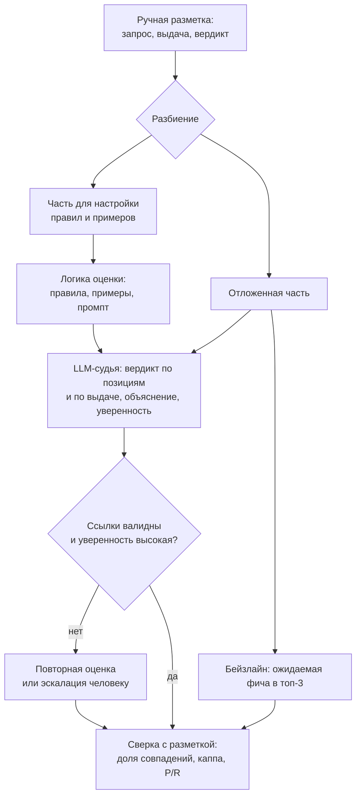
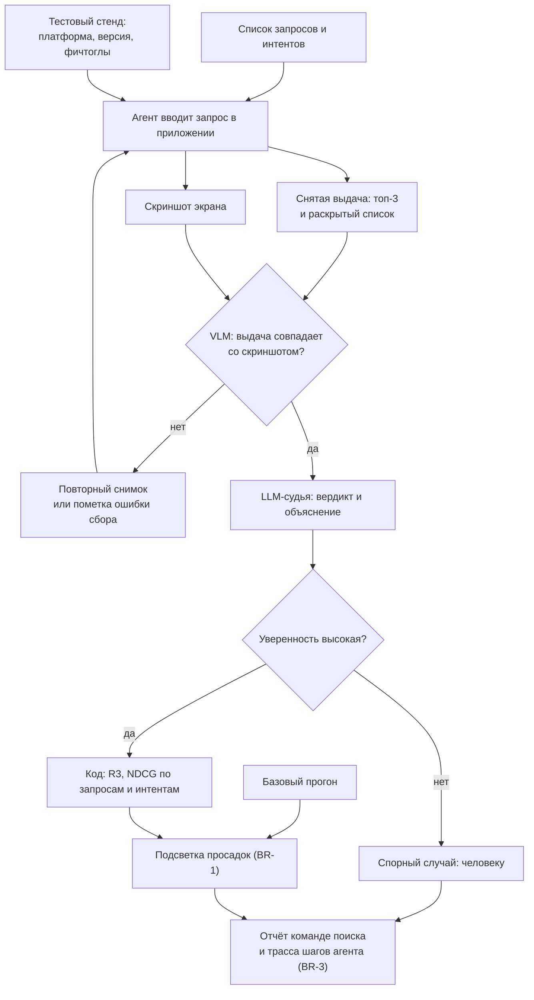

# ML System Design Doc — [RU]

## Дизайн ML-системы: AI-оценщик поисковой выдачи Альфа-Онлайн и Альфа-Мобайл, MVP, итерация 1

*Документ составлен по структуре [шаблона ML System Design Doc от Reliable ML](https://github.com/IrinaGoloshchapova/ml_system_design_doc_ru/blob/main/ML_System_Design_Doc_Template.md). Источники: описание кейса «Автоматизация тестирования с помощью ИИ» (Альфа-Банк) и BRD «Тестирование выдачи поиска». Всё, чего нет в этих материалах, помечено как **допущение** или **TBD** и вынесено в вопросы к заказчику (раздел 3).*

> **Статус согласования.** Ответов заказчика на наши вопросы пока нет. Поэтому пороги, формат разметки, доступы к моделям и стенду описаны как допущения. Документ дополним после ответов и после получения первых примеров разметки (до 13.11.2026).

> **Термины**
> - **Фича** — функция или продукт банка в приложении: кредит наличными, заправки, переводы.
> - **Выдача** — упорядоченный список фич, который приходит в ответ на поисковый запрос.
> - **Интент** — цель клиента, за которой стоит группа запросов, например «вклады».
> - **Топ-3** — результаты, которые клиент видит без раскрытия списка.
> - **Точка** — один размеченный пример: запрос, выдача, вердикт, объяснение.
> - **Эталон (ground truth)** — ручная разметка, которую считаем правдой.
> - **R3** — сколько из топ-3 релевантны интенту.
> - **NDCG** — насколько высоко в выдаче стоят самые релевантные фичи.
> - **CTR3** — на что из топ-3 кликнули и насколько это правильно.
> - **Классификатор** — модель банка, которая подбирает фичи к запросу. Это объект тестирования, а не часть нашей системы.
> - **Фичтогл** — переключатель, который включает фичу не всем клиентам.
> - **AlfaGen** — внутренняя платформа банка с языковыми моделями.
> - **LLM-судья** — языковая модель, которая выносит вердикт о релевантности выдачи по заданным правилам.

### 1. Цели и предпосылки

#### 1.1. Зачем идем в разработку продукта?

**Бизнес-цель.** Снять с команды поиска часть ручной проверки выдачи и быстрее находить просадки качества поиска в «Альфа-Онлайн» и «Альфа-Мобайл».

**Проблема сейчас:**
- Клиент без раскрытия списка видит только три результата, поэтому релевантная фича обязана попадать в топ-3.
- Выдачу проверяют люди вручную. Кейсов много, поэтому смотрят выборочно, и часть запросов не проверяется совсем.
- Просадки замечают с опозданием. Когда в поиск добавляют новые фичи, классификатор может деградировать на старых запросах, и нужная фича съезжает ниже.

**Почему станет лучше с ML.** Правилами типа «точное совпадение заголовка» релевантность не оценить: клиенты формулируют запросы по-разному («вклад» и «депозит»), а релевантными могут быть несколько фич. LLM-судья оценивает смысловое соответствие выдачи интенту так, как это делает разметчик, но на всём наборе запросов и после каждого релиза. Ручная проверка остаётся для спорных случаев, которые система сама передаёт человеку.

**Успех итерации для бизнеса.** Критерий успеха из BRD — доля совпадений вердиктов системы с ручной разметкой. Целевой порог — **TBD** (вопрос В4). Кроме того, итерация успешна, если на демонстрации команда поиска видит по каждому запросу вердикт с объяснением, метрики и подсвеченные просадки, а также может пройти по шагам работы агента.

#### 1.2. Бизнес-требования и ограничения

**Бизнес-требования (из BRD):**

| № | Требование |
| --- | --- |
| BR-1 | Подсвечивать запросы, которые просели, в том числе когда нужная фича съехала ниже |
| BR-2 | Собирать выдачу по каждому запросу с учётом платформы и версии. Главное — верхние 3 позиции |
| BR-3 | Флоу работы агента виден: его можно посмотреть по шагам и оценить логику |
| BR-4 | По каждой выдаче даётся вердикт с объяснением. Ground truth — разметка |

**Целевой пользователь** — команда поиска. Она получает подсветку просадок и решает, на что обратить внимание.

**Бизнес-ограничения:**
- **Модели.** Используем LLM и VLM платформы AlfaGen. Можно ли использовать внешние или локально развёрнутые модели — **TBD** (В5). Для разработки команда может развернуть VLM на своей GPU с 24 ГБ видеопамяти, если банк это разрешит.
- **Данные.** Запросы, выдача и разметка — внутренние данные банка. Передавать их во внешние сервисы без согласования нельзя.
- **Среда.** Прогоны выполняются на тестовом стенде банка. Состояние фичтоглов влияет на выдачу: фича под выключенным тогглом не покажется, и это даст ложную «просадку». Как управлять тогглами — **TBD** (В7).
- **Разметка.** Первые примеры от Полины придут до 13.11.2026, полный набор (50–100 кейсов на интент) — к 20.11.2026. До этих дат калибровка возможна только на синтетических примерах.
- **Проверяемость.** Вывод агента нельзя принимать на веру. Каждый вердикт должен ссылаться на позиции выдачи и интент, а неуверенные вердикты должны уходить человеку.
- **Скоуп.** Нужен не универсальный тестировщик, а согласованный контур: поисковая выдача.

**Что ожидаем от итерации.** Работающий оценщик, откалиброванный на разметке, с измеренной долей совпадений. Прототип рабочего прогона хотя бы на одной платформе. Демонстрация команде поиска.

**Как система встраивается в процесс.** Сейчас разметчик вручную вбивает запрос, смотрит выдачу и решает, корректна ли она. В пилоте ручная проверка не отключается:
1. Команда поиска задаёт список запросов и интентов. Разметчики размечают эталон.
2. После релиза или по расписанию (частота — **TBD**, В6) система прогоняет запросы на стенде, выносит вердикты, считает метрики и сравнивает их с базовым прогоном.
3. Команда поиска получает отчёт: подсвеченные запросы, вердикты с объяснениями, трассу шагов агента. Спорные случаи разметчик проверяет вручную.

**Успешный пилот и развитие.** Пилот успешен, если доля совпадений с ручной разметкой не ниже согласованного порога, а система находит реальные просадки при смене версии без большого числа ложных срабатываний. Пути развития: глубокая проверка карточки фичи (агент открывает её, а VLM сверяет экран с интентом), синтетические профили клиентов разных архетипов, расширение на iOS и web, встраивание в CI релизов.

#### 1.3. Что входит в скоуп проекта/итерации, что не входит

**Входит в итерацию:**
- **Этап 1 BRD — калибровка оценщика.** Логика оценки на первых примерах, вердикты по полному набору «запрос и выдача», сверка с ручной разметкой и подсчёт доли совпадений.
- **Этап 2 BRD — рабочий прогон.** Агент вводит запросы в приложении на тестовом стенде, снимает выдачу с учётом платформы и версии (BR-2), оценивает её (BR-4), считает R3 и NDCG и подсвечивает просадки (BR-1).
- **Трасса агента (BR-3).** Для каждого запроса сохраняются шаги: ввод, снятая выдача, скриншот, промпт и ответ судьи, итоговый вердикт.
- **Самопроверка.** Привязка вердикта к позициям выдачи и интенту, повторная оценка спорных случаев, фиксация уверенности, эскалация человеку.
- **Обзор практик AI- и агентного тестирования** — как вход для выбора подхода, из описания кейса.
- **Демонстрация команде поиска (этап 3 BRD).**

**Не входит:**
- Универсальный тестировщик для любых продуктов банка.
- Изменение самого классификатора поиска. Мы его тестируем, а не дообучаем.
- Глубокая проверка карточек (что открывает фича), синтетические профили клиентов и поиск фич без поисковой строки. Это наши предложения из раздела 6 вопросов к заказчику, они пойдут в следующие итерации, если заказчик их согласует.
- Обязательная поддержка iOS и web. Стартуем с одной платформы, по умолчанию Android (**допущение**, В3). Вторая платформа — дополнительный трек.
- CTR3 по реальным кликам, пока нет источника продовой аналитики (В8).
- Продовая эксплуатация: SLA, мониторинг, интеграция в TestOps.

**Качество кода и воспроизводимость:** репозиторий с Ruff и pre-commit; зафиксированные версии промптов и логики оценки; набор тестовых заданий и артефактов для воспроизводимой оценки; каждый прогон сохраняется с платформой, версией приложения и версией оценщика.

**Технический долг, который осознанно откладываем:** инфраструктура для регулярных прогонов (CI или планировщик), веб-дашборд вместо статического отчёта, поддержка матрицы версий.

#### 1.4. Предпосылки решения

- **Единица оценки** — пара «запрос и выдача» на конкретной платформе и версии. Основной фокус — топ-3, раскрытый список снимаем для диагностики просевших фич (**допущение**, В2).
- **Эталон** — ручная разметка команды поиска. Её формат (бинарная релевантность позиций или вердикт по выдаче целиком, шкала) — **TBD** (В1). До ответа проектируем оценщик так, чтобы он выдавал и оценку каждой позиции топ-3, и вердикт по выдаче целиком.
- **Источники данных:**

| Блок | Что это | Зачем |
| --- | --- | --- |
| Список запросов и интентов | Частые запросы, сгруппированные по интентам, 50–100 кейсов на интент | Вход прогона |
| Ручная разметка | Запрос, выдача, вердикт, объяснение | Эталон для калибровки и оценки |
| Каталог фич | Название, описание и, при наличии, диплинк фичи | Контекст для судьи: чем фича является |
| Выдача на стенде | Упорядоченный список фич и скриншот экрана | Объект оценки |
| Базовый прогон | Метрики предыдущей версии или прошлого прогона | Сравнение для поиска просадок |

- **Горизонт и частота.** Прогноза нет. Система оценивает текущее состояние выдачи. Прогон запускается по релизу или по расписанию (**TBD**, В6).
- **Просадка (допущение до ответа на В6).** Ожидаемая фича интента выпала из топ-3, либо R3 или NDCG запроса упали относительно базового прогона больше порога. Порог подбираем на этапе 1.
- **Модели.** Готовые LLM и VLM без дообучения. Качество достигается правилами оценки в промпте, примерами из разметки и самопроверкой.
- **Метрики R3 и NDCG** считает детерминированный код по вердиктам позиций. LLM метрики не считает: так их можно воспроизвести и проверить.

### 2. Методология

#### 2.1. Постановка задачи

**Техническая задача** — оценка релевантности поисковой выдачи с помощью LLM-судьи (LLM-as-a-judge) плюс агент, собирающий выдачу в интерфейсе. Это не задача ранжирования: мы не строим поиск, а проверяем, насколько выдача классификатора соответствует интенту запроса.

**Компоненты:**
1. **Сборщик выдачи (этап 2).** Агент вводит запрос в приложении на стенде (Appium для мобильного приложения или Playwright для web) и снимает упорядоченный список фич. VLM сверяет снятый список со скриншотом экрана, чтобы не оценивать ошибку парсинга вместо ошибки поиска.
2. **LLM-судья.** На вход: запрос, интент, топ-3 (и раскрытый список), описания фич из каталога, правила оценки, примеры из разметки. На выход: релевантность каждой позиции, вердикт по выдаче, объяснение со ссылками на позиции, уверенность.
3. **Самопроверка.** Структурированный ответ проверяется: каждая позиция, на которую ссылается объяснение, должна существовать в выдаче, а фича — в каталоге. При низкой уверенности или расхождении повторных прогонов судьи (другая формулировка, другая модель) случай помечается спорным и уходит человеку.
4. **Метрики и просадки.** Код считает R3 и NDCG по запросу и интенту, сравнивает с базовым прогоном и подсвечивает просевшие запросы.
5. **Трасса и отчёт.** Для каждого запроса доступны все шаги агента (BR-3).

**Бейзлайн:** правило без ML — «вердикт положительный, если ожидаемая фича интента из разметки есть в топ-3 по точному совпадению названия». Бейзлайн не понимает синонимов и не оценивает несколько релевантных фич, поэтому ожидаем, что LLM-судья совпадёт с разметкой чаще.

**Метрики:**
- **Качество оценщика (главная, критерий BRD).** Доля совпадений вердиктов с ручной разметкой (accuracy), а также каппа Коэна, чтобы учесть случайное совпадение. Precision и recall по классу «выдача некорректна», потому что пропущенная просадка и ложная тревога стоят по-разному.
- **Качество сборщика.** Доля запросов, где снятая выдача совпала с экраном (сверка со скриншотом).
- **Качество поиска (то, что отдаём команде поиска).** R3 и NDCG@3 по запросам и интентам. CTR3 — только при появлении источника кликов (В8).
- **Поиск просадок.** Доля найденных искусственно внесённых просадок (переставляем фичи в зафиксированной выдаче) и доля ложных срабатываний.
- **Стоимость.** Время и стоимость прогона на один запрос в сравнении с ручной проверкой. Доля случаев, ушедших человеку.

**Оценка.** Этап 1: размеченный набор делим на часть для настройки правил и примеров в промпте и отложенную часть для итогового замера доли совпадений. Этап 2: прогон на двух версиях приложения или на зафиксированной выдаче с внесёнными просадками.

#### 2.2. Блок-схема решения

**Этап 1. Калибровка оценщика на размеченных данных**

**Этап 2. Рабочий прогон**

#### 2.3. Этапы решения задачи (план)

1. Обзор практик AI- и агентного тестирования и выбор подхода к оценщику.
2. Бейзлайн и первая версия LLM-судьи на первых примерах разметки (до 13.11.2026).
3. Калибровка на полном наборе (с 20.11.2026), замер доли совпадений на отложенной части.
4. Сборщик выдачи на одной платформе, сверка со скриншотом.
5. Метрики, поиск просадок и отчёт с трассой агента.
6. Демонстрация команде поиска и рекомендации для пилота.

### 3. Открытые вопросы к заказчику

Полный список с приоритетами ведётся в отдельном документе команды. Ниже — вопросы, от которых зависят решения этого документа.

- **В1 (P0).** Формат разметки: бинарная релевантность каждой позиции или вердикт по выдаче целиком? Какая шкала? Как поступать с синонимами и несколькими одинаково релевантными фичами?
- **В2 (P1).** Оцениваем только топ-3 или всю выдачу? Нужно ли снимать раскрытый список для диагностики съехавших фич?
- **В3 (P0/P1).** Какие платформы и версии тестируем, где брать сборки и тестовый аккаунт? Допустим ли порядок «сначала Android»?
- **В4 (P2).** Какой порог доли совпадений с разметкой считается успехом?
- **В5 (P0).** Какие модели AlfaGen доступны и как получить ключи? Можно ли использовать локально развёрнутую модель?
- **В6 (P1).** С чем сравниваем при поиске просадок (прошлый прогон, прошлая версия, разметка) и с какой частотой запускаем? Какой порог считать просадкой?
- **В7 (P1).** Включены ли на стенде все фичтоглы и как управлять их состоянием?
- **В8 (P1).** Есть ли источник данных о кликах для CTR3?
- **В9 (P1).** В каком виде отдаём результат команде поиска и что показываем на демонстрации?
