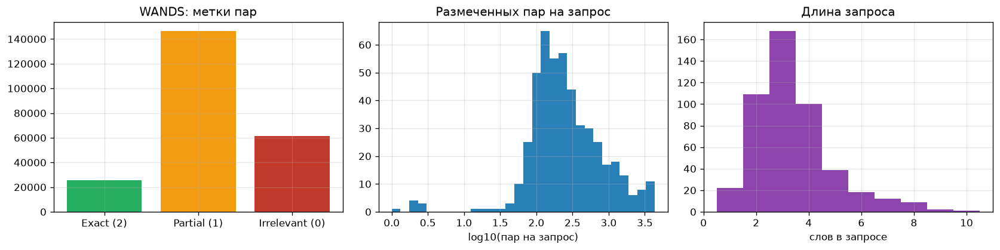
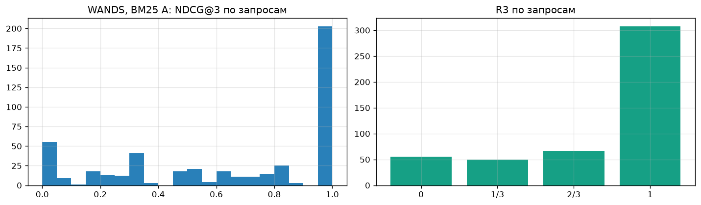
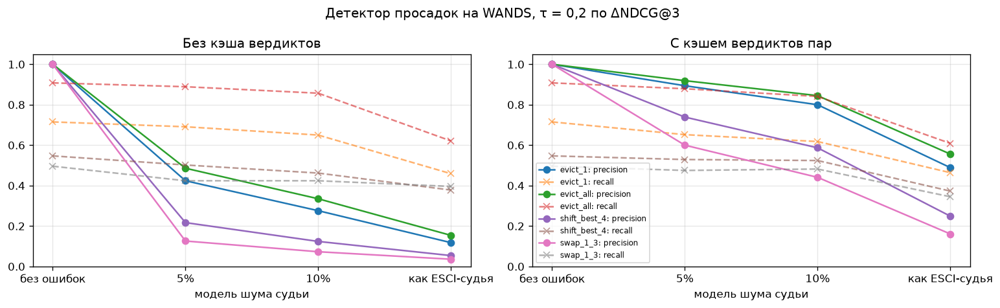
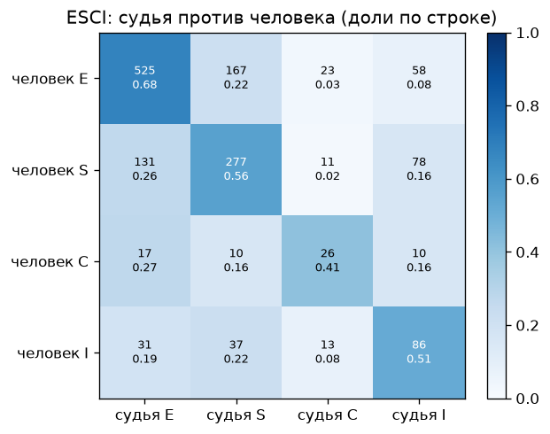
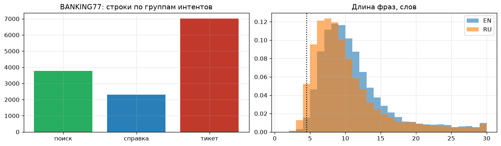
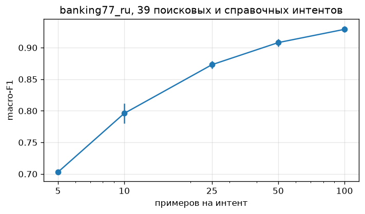
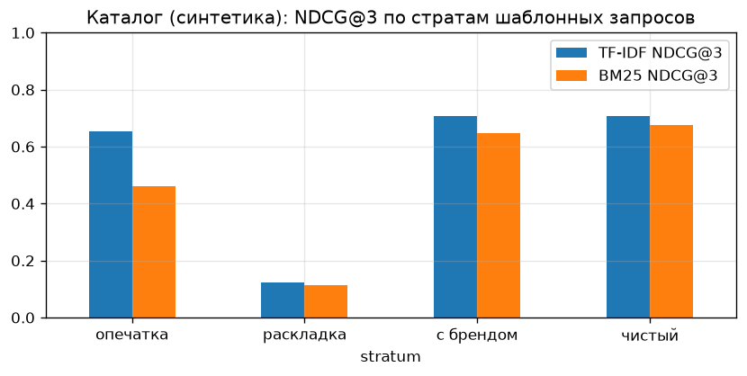
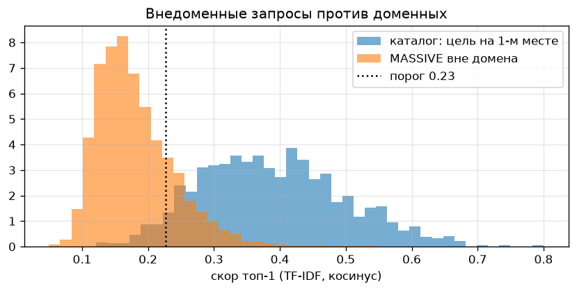

# EDA: отчёт (версия 2)

> **Прокси до получения данных банка.** Данных Альфа-Банка у команды пока нет: первые примеры разметки ожидаются до 13.11.2026, полный набор — к 20.11.2026. Все числа ниже посчитаны на **публичных прокси-датасетах** и на **синтетическом каталоге фич**, который написан вручную и помечен как допущение. Выводы о данных банка — гипотезы, которые проверим на реальной выгрузке тем же кодом.

Основной ноутбук: [`notebooks/02_eda_search_proxies.ipynb`](../../notebooks/02_eda_search_proxies.ipynb), выполняется целиком на CPU примерно за 2 минуты. Первая версия [`01_eda_proxy.ipynb`](../../notebooks/01_eda_proxy.ipynb) сохранена как дополнительный анализ свойств текста (раздел 7 ниже). Код: [`src/mlsd_course/eda/`](../../src/mlsd_course/eda/). Датасеты и как их скачать: [`data/README.md`](../../data/README.md).

## Главное

1. **Основной прокси для метрик выдачи — WANDS.** Это короткие запросы (медиана 3 слова, 83% — до 4 слов), шкала Exact / Partial / Irrelevant (то же, что наши 2/1/0) и реальная выдача. Бейзлайн BM25 даёт NDCG@3 = 0,647 [0,613; 0,681] на 480 запросах. Ширина интервала ±0,03 — порядок минимальной разницы между версиями поиска, которую можно заметить на такой выборке.
2. **R3 без договорённости о «релевантном» вводит в заблуждение.** На WANDS R3 = 0,769, если релевантным считать rel ≥ 1, и 0,392, если только rel = 2. На каталоге потолок R3 зависит от числа фич в разделе: в среднем 0,938, у запросов ssq_ru — 0,636. Основная метрика — NDCG@3, а R3 нормируем на потолок или сравниваем только в пределах одного каталога.
3. **LLM-судья «из коробки» шумный.** На ESCI (1 500 пар, судья против людей вслепую) accuracy по 4 классам — 0,609 (κ 0,380), по нашей шкале 2/1/0 — 0,625 (κ 0,393, квадратичная κ 0,449), по свёртке «релевантно / нет» — 0,823. Половина расхождений (50,9%) — соседние классы Exact и Substitute.
4. **Шум судьи переходит в метрики.** Если оценивать топ-3 судьёй с эмпирической матрицей ошибок ESCI, MAE NDCG@3 = 0,233, NDCG@3 занижается с 0,780 до 0,668, R3 запроса совпадает только в 62,6% случаев. Судью калибруем на разметке Полины до того, как отдавать метрики команде поиска.
5. **Шум судьи — главный источник ложных тревог детектора просадок.** На реальной выдаче WANDS с синтетическими деградациями и нейтральными изменениями 30% выдач precision детектора (τ = 0,2) без кэша — 0,31 при 5% ошибок судьи, 0,20 при 10%, 0,09 при шуме ESCI-судьи. С кэшем вердиктов пар — 0,79, 0,67 и 0,36 при той же полноте. Повышение порога τ точность почти не поднимает, а полноту режет вдвое.
6. **Поиском решается меньше половины банковских интентов.** По ручной группировке BANKING77 поисковых — 24 интента (28,8% строк), справочных — 15 (17,6%), тикетов-инцидентов — 38 (53,6%). Тестовый набор поиска строим из 39 поисковых и справочных интентов.
7. **50–100 кейсов на интент — разумный объём.** На banking77_ru по 39 интентам macro-F1 растёт с 0,703 при 5 примерах на интент до 0,908 при 50 и 0,929 при 100. 12,1% тестовых фраз дословно есть в train, поэтому делим по нормализованному тексту.
8. **Обязательные страты тестового набора.** Неверная раскладка ломает оба бейзлайна (NDCG@3 0,12 против 0,71 у чистых запросов), опечатка снижает NDCG@3 BM25 с 0,675 до 0,461. 19,1% внедоменных фраз MASSIVE получают «уверенный» банковский ответ. У 21% запросов WANDS и у 51% финансовых запросов ssq_ru нет точного ответа.
9. **Формат будущей разметки проверен.** На синтетическом каталоге (48 фич, 3 464 запроса, оценки 0/1/2) прогнаны бейзлайны, метрики и шаблон EDA для выгрузки банка. На реальных данных они запустятся без правок.

## 1. Паспорт прокси-датасетов

| Датасет | Домен | Язык | Медиана слов / до 4 слов | Метки | Пары query–doc | Лицензия | Роль | Моделирует | Не моделирует |
| --- | --- | --- | --- | --- | --- | --- | --- | --- | --- |
| [WANDS](https://github.com/wayfair/WANDS) | e-commerce | en | 3 / 83,1% | Exact / Partial / Irrelevant → 2/1/0 | 233 448 | MIT | **основной**: метрики, бейзлайн, просадки | градуированную разметку, реальную выдачу, запросы без точного ответа | банк, русский язык |
| [ESCI LLM-judged](https://huggingface.co/datasets/johannhartmann/esci-llm-judged-top10) | e-commerce | en | 4 / 70,8% | E/S/C/I, судья и человек | 21 292 + 1 500 калибровочных | Apache-2.0 | **судья** | ошибки LLM-судьи против людей | банк, наш промпт и модели AlfaGen |
| [BANKING77](https://huggingface.co/datasets/PolyAI/banking77) | банк | en | 10 / 1,8% | 77 интентов | нет | CC BY 4.0 | словарь интентов | банковские интенты, близкие пары | выдачу, кредиты и вклады, короткие запросы |
| [banking77_ru](https://huggingface.co/datasets/DeepPavlov/banking77_ru) | банк | ru, перевод | 8 / 6,5% | 77 интентов | нет | не указана | русские формулировки | русскую банковскую лексику | живые запросы, выдачу |
| [synthetic-search-queries-ru](https://huggingface.co/datasets/EmbeddingStudio/synthetic-search-queries-ru), 9 фин. категорий | финансы и смежное | ru, GPT-4 | 8 / 6,3% | категория | нет | Apache-2.0 | стресс-набор к каталогу | лексику продуктов | реальное распределение запросов |
| [MASSIVE ru-RU](https://github.com/alexa/massive) | голосовой ассистент | ru | 5 / 35,9% | 60 интентов | нет | CC BY 4.0 | **контроль вне домена** | разговорный русский | банк (финансов 2,5%) |
| Синтетический каталог | банк, **допущение** | ru | 2–8 по источникам | 0/1/2 по правилам | 166 272 | наш | формат разметки банка | «запрос → фича», страты | реальный каталог банка |

Ни один публичный датасет не даёт сразу банковский домен, русский язык и разметку пар «запрос–фича». Поэтому свойства раскладываем по датасетам: выдача и метрики — WANDS, судья — ESCI, банковские интенты и русский язык — BANKING77 и banking77_ru, формат разметки — синтетический каталог.

## 2. WANDS: разметка пар, бейзлайн и просадки

- 480 запросов, 42 994 товара, 233 448 пар. Метки: Partial — 62,8%, Irrelevant — 26,2%, Exact — 11,0%. Пар на запрос — от 1 до 4 329, медиана 216,5.
- У 101 запроса (21,0%) нет ни одного точного ответа. **Для проекта:** разметке банка нужна явная возможность «целевой фичи нет», а метрике — не штрафовать поиск за невозможное.

**Бейзлайн и метрики.** R3 — доля позиций топ-3 с rel ≥ 1. NDCG@3 считается с усилением 2^rel − 1 и нормируется на идеальную выдачу из всех размеченных пар (код: `ranking.py`). Интервалы — бутстрап по запросам.

| Выдача | R3 | NDCG@3 | R3 строгий (rel = 2) | Размечено позиций топ-3 |
| --- | --- | --- | --- | --- |
| BM25 А: название + класс + категория | 0,769 [0,737; 0,800] | 0,647 [0,613; 0,681] | 0,392 | 86,9% |
| BM25 Б: + описание | 0,794 [0,765; 0,823] | 0,662 [0,629; 0,692] | 0,406 | 84,5% |

- Интервалы вариантов А и Б пересекаются: на 480 запросах разница в 0,015 NDCG@3 не значима.
- 13,1% позиций топ-3 не размечены и засчитаны нерелевантными, поэтому метрика занижена. **Для проекта:** каждая новая фича в выдаче после релиза должна получить оценку судьи или человека.
- Распределение по запросам бимодальное: у 55 запросов NDCG@3 = 0, у 202 — 1.

**Синтетические просадки на реальной выдаче.** Это синтетика поверх реальных данных. «Релиз» портит топ-3 у 10% запросов: меняет местами позиции 1 и 3, сдвигает лучшую позицию на 4-е место, вытесняет одну или все релевантные позиции нерелевантными товарами того же запроса. Ещё у 30% запросов выдача меняется нейтрально, с той же разметкой. Судья ошибается равномерно с вероятностью 5% или 10% либо по эмпирической матрице ESCI-судьи (раздел 3). Итоги суммируются по 10 случайным релизам.

| Шум судьи (τ = 0,2) | Precision без кэша | Precision с кэшем | Recall без кэша | Recall с кэшем |
| --- | --- | --- | --- | --- |
| без ошибок | 1,000 | 1,000 | 0,666 | 0,666 |
| 5% | 0,313 | 0,788 | 0,626 | 0,634 |
| 10% | 0,202 | 0,668 | 0,598 | 0,616 |
| как ESCI-судья | 0,090 | 0,364 | 0,464 | 0,448 |

Средние по четырём типам деградации. По человеческой разметке ΔNDCG@3 составляет −0,687 при вытеснении всех релевантных позиций, −0,389 при вытеснении одной, −0,258 при сдвиге на 4-е место и −0,191 при перестановке позиций 1 и 3. Перестановку внутри топ-3 R3 не видит вовсе.

- При τ = 0,1 → 0,3 (5% шума, кэш) precision 0,786 → 0,725, recall 0,840 → 0,434: порог шум не лечит.
- **Для проекта:** кэшируем вердикты пар «запрос–фича» и оцениваем только новые пары. Просадку подтверждаем фактом изменения снятой выдачи. При шуме уровня ESCI-судьи подсвеченные запросы перепроверяем повторным прогоном судьи или отдаём человеку.

## 3. ESCI LLM-judged: согласие судьи с людьми

| Шкала | Accuracy | κ Коэна | Квадратичная κ |
| --- | --- | --- | --- |
| E/S/C/I, 4 класса | 0,609 | 0,380 | — |
| Наша шкала 2/1/0 (E → 2, S → 1, C + I → 0) | 0,625 | 0,393 | 0,449 |
| E против остальных | 0,715 | 0,432 | — |
| E + S против C + I | 0,823 | 0,400 | — |

- Числа пересчитаны по данным и совпадают с карточкой датасета.
- На парах из реальной выдачи (pooled, n = 1 000) судья точнее, чем на остальных (n = 500): 0,651 против 0,526 по 4 классам.
- Precision судьи по классу E — 0,746, по C и I — 0,356 и 0,371. Судья строже людей к атрибутам: например, для «cream leather sofa» он понижает точный ответ людей до S с объяснением «Velvet sofa, not leather».
- **Для проекта:** первые примеры Полины кладём в промпт судьи, остальное оставляем на отложенную проверку. Согласие меряем и по шкале 0/1/2, и по свёртке «целевая / нет». Калибровку проводим на парах из реальной выдачи. Матрицу ошибок судьи используем для выбора порога детектора.

## 4. BANKING77 и banking77_ru

| Группа (ручное допущение) | Интентов | Строк | Доля |
| --- | --- | --- | --- |
| Поиск: фича приложения | 24 | 3 765 | 28,8% |
| Справка: тарифы, лимиты, страны | 15 | 2 300 | 17,6% |
| Тикет: инцидент по операции | 38 | 7 018 | 53,6% |

- banking77_ru — перевод: медиана 8 слов против 10 в оригинале, до 4 слов — 6,5% против 1,8%. Это обращения, а не поисковые запросы. 2 строки остались без перевода.
- В русской версии 636 групп дублей (1 538 строк), в 31 группе одинаковый текст размечен разными интентами. 373 тестовые фразы (12,1%) дословно есть в train.

| Примеров на интент | 5 | 10 | 25 | 50 | 100 |
| --- | --- | --- | --- | --- | --- |
| macro-F1, 39 поисковых и справочных интентов, RU | 0,703 | 0,796 | 0,873 | 0,908 | 0,929 |

## 5. Синтетический каталог фич Альфа-Банка (допущение)

Каталог [`data/synthetic/alfa_feature_catalog.csv`](../../data/synthetic/alfa_feature_catalog.csv) состоит из 48 карточек в 13 разделах. К нему 3 464 запроса:

- 2 160 коротких (до 6 слов) фраз banking77_ru поисковых и справочных интентов;
- 452 финансовых запроса ssq_ru, сопоставленных с карточками правилами. Сопоставить удалось только 49,0% из 923, остальные — не про продукты банка;
- 852 шаблонных запроса.

Метки: 2 — целевая фича, 1 — фича того же раздела, 0 — остальные. Ручная проверка: из 40 сопоставлений ssq_ru 25 верны, 13 спорны (например, налоговые консультанты, которых нет у банка), 2 ошибочны; из 20 фраз banking77_ru 18 верны и 2 спорны.

| Бейзлайн | R3 | NDCG@3 | Цель на 1-м месте | Потолок R3 |
| --- | --- | --- | --- | --- |
| TF-IDF, символьные n-граммы 2–5 | 0,439 [0,428; 0,449] | 0,575 [0,563; 0,588] | 54,2% | 0,938 |
| BM25, псевдоосновы 5 букв | 0,401 [0,391; 0,411] | 0,526 [0,514; 0,538] | 48,2% | 0,938 |

| Страта | NDCG@3, TF-IDF | NDCG@3, BM25 |
| --- | --- | --- |
| Чистый синоним | 0,707 | 0,675 |
| С брендом | 0,706 | 0,647 |
| Опечатка | 0,653 | 0,461 |
| Неверная раскладка | 0,122 | 0,115 |

Шаблон EDA `bank_eda` для выгрузки банка отработал на этой выдаче без правок: 3 179 уникальных запросов, 87 интентов, у 65 из них меньше 50 запросов, 31,7% вердиктов `not_ok`, 7 одинаковых текстов с разными интентами.

## 6. MASSIVE ru-RU: контроль вне домена

- Финансовых фраз — 415 из 16 521 (2,5%: `qa_currency` и `qa_stock`).
- Порог уверенного ответа (5-й перцентиль скора правильного топ-1 у доменных запросов) — 0,227. Его превышают 19,1% внедоменных фраз, например «какой номер телефона у коли» → «Перевод по номеру телефона».
- Вопросы о курсах (`qa_currency`) находят «Курсы валют» или «Обмен валюты» на 1-м месте только в 56,8% случаев.
- **Для проекта:** в тестовый набор входит внедоменная страта с ожидаемым ответом «нет релевантной фичи», а судья умеет вынести вердикт «ничего релевантного в топ-3».

## 7. Дополнительно: свойства текста (первая версия EDA)

Подробно — в [`01_eda_proxy.ipynb`](../../notebooks/01_eda_proxy.ipynb). Игрушечная синтетическая выдача из первой версии заменена разделом 2.

- **Баланс интентов** ([график](01_intent_balance.png)). BANKING77 train: от 35 до 187 примеров на интент. MASSIVE ru: от 4 до 810. Минимум разметки задаём на каждый интент.
- **Длина запросов** ([график](02_query_length.png)). Короткий запрос неоднозначен, поэтому разметка допускает несколько релевантных фич.
- **Дубли в MASSIVE ru.** 1 455 строк (8,8%) в группах дублей, 36 конфликтных групп, 208 тестовых запросов дословно есть в train.
- **Опечатки, морфология, латиница** ([график](03_ru_script_morphology.png)). Настоящих опечаток среди кандидатов эвристики — 30% в BANKING77 и 10% в MASSIVE ru. 7,6% русских запросов смешивают кириллицу и латиницу, в основном это бренды.
- **Близкие интенты** ([график](04_intent_similarity_heatmap.png)). Самая близкая пара — `verify_my_identity` и `why_verify_identity`, косинус 0,91.
- **Согласие разметчиков MASSIVE** ([график](06_annotator_agreement.png)). Единогласие трёх проверяющих — 85,6%, у худших интентов — 51–59%. Нужен поднабор с двойной разметкой.
- **Размер отложенной части** ([график](08_holdout_size_ci.png)). При 50 точках на интент доля совпадений известна с точностью ±8,5–11 п. п.

## Ограничения

- Выдача и судья смоделированы на e-commerce (WANDS, ESCI): товаров там десятки тысяч, а фич в банковском поиске — десятки. Переносим свойства метрик и шума, а не абсолютные значения.
- Каталог фич, правила сопоставления ssq_ru и группировка интентов BANKING77 — ручные допущения. banking77_ru — перевод, лицензия в карточке не указана. ssq_ru сгенерирован GPT-4.
- Судья в ESCI — `claude-haiku-4-5` с промптом авторов датасета, а не наш промпт и не модели AlfaGen. Матрица ошибок — оценка порядка величины.
- Просадки синтетические: реальные деградации после релизов могут выглядеть иначе. CTR3 и сбор выдачи через VLM в этом EDA не моделируются, план — в разделе 2.3 дизайн-дока.
