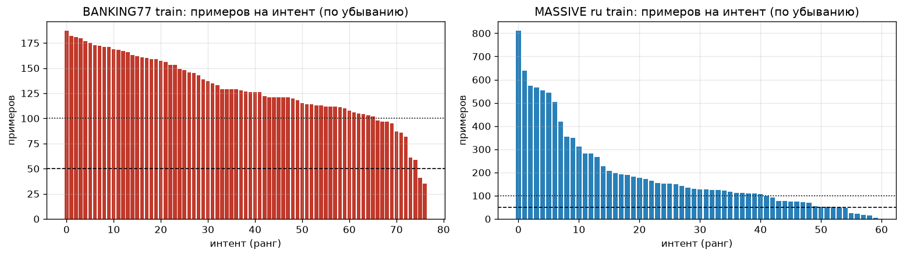
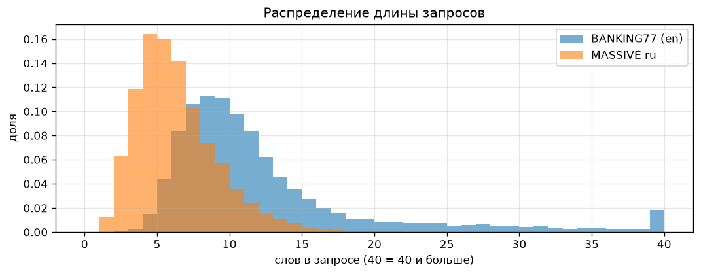
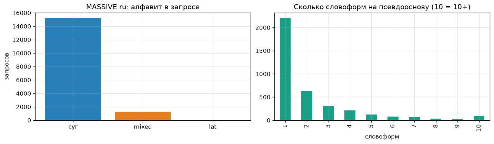
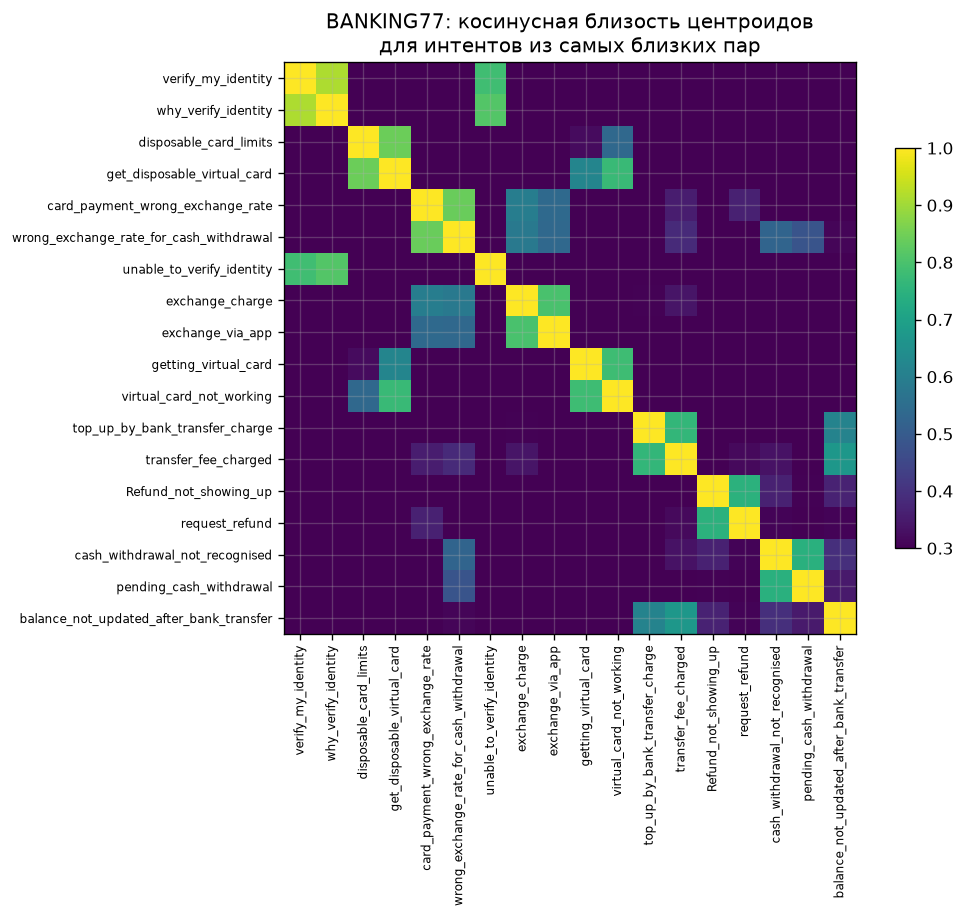
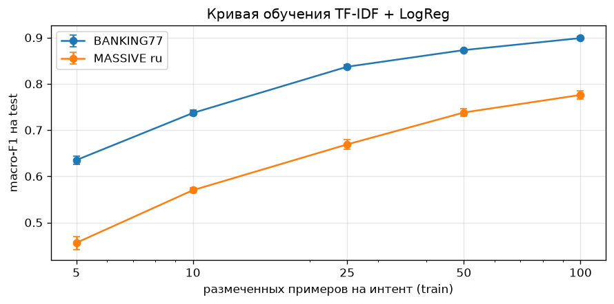
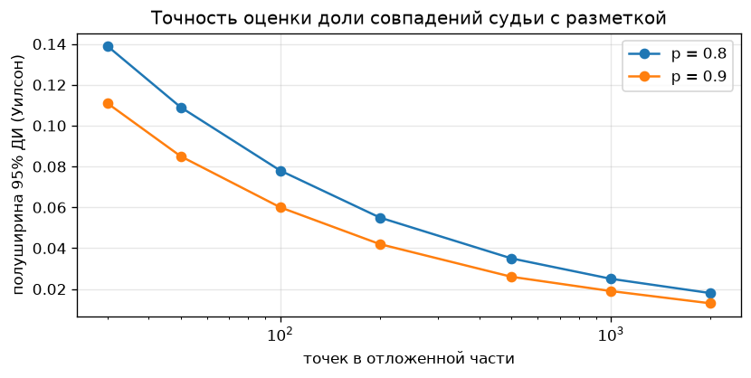
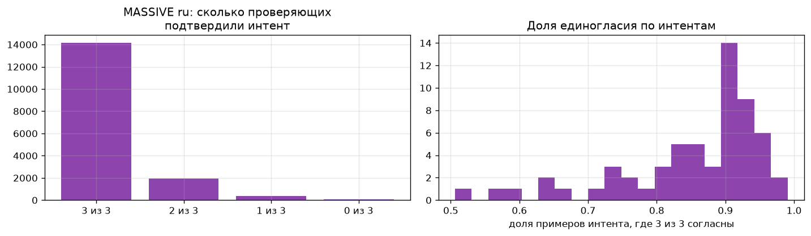
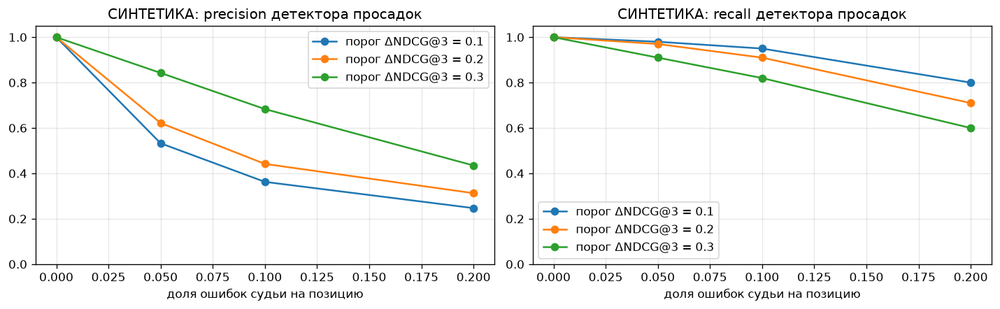

# EDA: отчёт

> **Прокси до получения данных банка.** Данных Альфа-Банка у команды пока нет: первые примеры разметки ожидаются до 13.11.2026, полный набор — к 20.11.2026. EDA выполнен на публичных прокси-датасетах [BANKING77](https://huggingface.co/datasets/PolyAI/banking77) и [MASSIVE ru-RU](https://github.com/alexa/massive), а свойства выдачи — на **синтетике**. Все числа ниже относятся к прокси. Выводы о данных банка — гипотезы, которые проверим на реальной выгрузке тем же кодом.

Полный анализ с кодом: [`notebooks/01_eda_proxy.ipynb`](../../notebooks/01_eda_proxy.ipynb). Код: [`src/mlsd_course/eda/`](../../src/mlsd_course/eda/). Датасеты и формат данных банка: [`data/README.md`](../../data/README.md).

## Зачем эти датасеты

| Датасет | Объём | Что моделирует |
| --- | --- | --- |
| BANKING77 | 13 083 запроса, 77 интентов | Банковские интенты: баланс, близкие и путающиеся интенты, опечатки |
| MASSIVE ru-RU | 16 521 запрос, 60 интентов, 3 оценки проверяющих на пример | Русские короткие запросы: морфология, латиница, дубли, согласие разметчиков |
| Синтетическая выдача | 1 000 запросов, 20 интентов, выдача из 8 фич | Поведение R3, NDCG@3 и детектора просадок при ошибках судьи |

Пропусков и пустых строк в обоих датасетах нет.

## 1. Баланс интентов

- BANKING77 train: от 35 до 187 примеров на интент (в 5,3 раза), test ровно по 40. MASSIVE ru train: от 4 до 810 (в 202 раза).
- До 50 примеров не дотягивают 2 интента BANKING77 и 6 интентов MASSIVE ru.
- **Для проекта:** 50–100 кейсов задаём как минимум на **каждый** интент и отбираем стратифицированно.

## 2. Длина запросов

- BANKING77: медиана 10 слов, 10,6% запросов длиннее 20 слов. MASSIVE ru: медиана 5 слов, 19,4% — не длиннее 3 слов.
- Поисковые запросы в приложении, вероятно, ещё короче (**допущение**). Короткий запрос неоднозначен, поэтому разметка должна допускать несколько релевантных фич, а судья — вердикт «неоднозначно».

## 3. Дубли и конфликты меток

- MASSIVE ru: 1 455 строк (8,8%) в 534 группах дублей после нормализации. В 36 группах (153 строки) один текст размечен разными интентами: «выключи свет» — 31 раз и 3 интента.
- BANKING77: 60 групп дублей и только 2 конфликтные.
- Дословно встречаются в train: 208 тестовых запросов MASSIVE ru и 25 тестовых BANKING77.
- **Для проекта:** делим выборку по нормализованному тексту запроса, дубли схлопываем, конфликты отдаём на повторную разметку.

## 4. Опечатки, морфология, латиница

- Эвристика «редкое слово в одной правке от частого» нашла 211 кандидатов в BANKING77 и 572 в MASSIVE ru. По ручной проверке случайных выборок настоящих опечаток среди них 30% (n = 40) и 10% (n = 30). В русском одна правка чаще даёт другую словоформу (`кухня → кухне`), чем опечатку.
- На одну псевдооснову (первые 5 букв) приходится в среднем 2,25 словоформы, у 25% — три и больше. 74 слова с «ё» встречаются и через «е».
- 7,6% запросов MASSIVE ru смешивают кириллицу и латиницу, в основном это бренды и сервисы (`facebook`, `google`, `uber`) и wake-word `olly` (2,2%).
- **Для проекта:** точное совпадение строк в бейзлайне ломается на морфологии и опечатках. В проверочный набор включаем страты «опечатка», «неверная раскладка», «латиница или бренд».

## 5. Близкие и путающиеся интенты

- Самая близкая пара BANKING77 по TF-IDF-центроидам — `verify_my_identity` и `why_verify_identity`, косинус 0,91. Дальше идут пары соседних продуктов и состояний одного процесса: одноразовая и обычная виртуальная карта, «неверный курс» при оплате и при снятии, «пополнение в ожидании» и «пополнение не прошло».
- TF-IDF + логистическая регрессия: accuracy 0,909 на BANKING77 и 0,831 на MASSIVE ru. Ошибается именно в близких парах, худшие интенты BANKING77 имеют F1 0,76–0,80.
- **Для проекта:** рискованные пары («вклад» и «накопительный счёт» и т. п.) согласуем с командой поиска, для них — больше разметки, двойная проверка и явные правила приоритета в промпте судьи.

## 6. Сколько разметки на интент

| Примеров на интент | 5 | 10 | 25 | 50 | 100 |
| --- | --- | --- | --- | --- | --- |
| macro-F1, BANKING77 | 0,635 | 0,737 | 0,837 | 0,873 | 0,899 |
| macro-F1, MASSIVE ru | 0,456 | 0,570 | 0,669 | 0,738 | 0,776 |

Основной прирост — до 25–50 примеров. Мы не обучаем модель на разметке, но кривая показывает разнообразие формулировок внутри интента: первых примеров хватит для промпта, а не для итоговой проверки.

Полуширина 95% доверительного интервала (Уилсон) для доли совпадений: при 50 точках — ±8,5–11 п. п., при 1 000 — ±1,9–2,5 п. п. (для p = 0,9 и 0,8). Итоговый критерий считаем по всей отложенной части, по интентам смотрим только сильные отклонения.

## 7. Согласие разметчиков

- В MASSIVE ru все 3 проверяющих подтвердили интент в 85,6% примеров, в 2,6% большинство его отвергло. У худших интентов доля единогласия 51–59%.
- **Для проекта:** ручная разметка — не идеальная правда. Нужен поднабор с двойной разметкой, и согласие судьи сравниваем с согласием человек–человек.

## 8. Синтетика: метрики выдачи и детектор просадок

> **Синтетические данные.** Каталог, запросы и ранжирование сгенерированы случайно. Имитируется релиз, после которого у 10% запросов целевая фича съезжает на 3 позиции вниз, и судья, который ошибается в заданной доле оценок позиций.

- На запросах с просадкой R3 падает с 1,0 до 0,667, NDCG@3 — с 0,957 до 0,395. R3 не различает потерю целевой и смежной фичи.
- При 5% ошибок судьи и пороге ΔNDCG@3 = 0,2 precision детектора — 0,62, при 10% — 0,44. Порог 0,3 даёт precision 0,84 и 0,68 при recall 0,91 и 0,82.
- **Для проекта:** оценки позиций нужны со шкалой. Просадку подтверждаем фактом изменения снятой выдачи и кэшируем вердикты неизменившихся выдач, чтобы шум судьи не давал ложных тревог.

## Ограничения

- Ни один прокси-датасет не содержит поисковую выдачу. Всё про позиции и топ-3 — только на синтетике.
- BANKING77 англоязычный и длиннее поисковых запросов. MASSIVE ru — не банковская тематика. Выводы переносим только по свойствам, указанным в таблице выше.
- Эвристики (опечатки, псевдоосновы) грубые, их точность оценена ручной проверкой небольших выборок.
